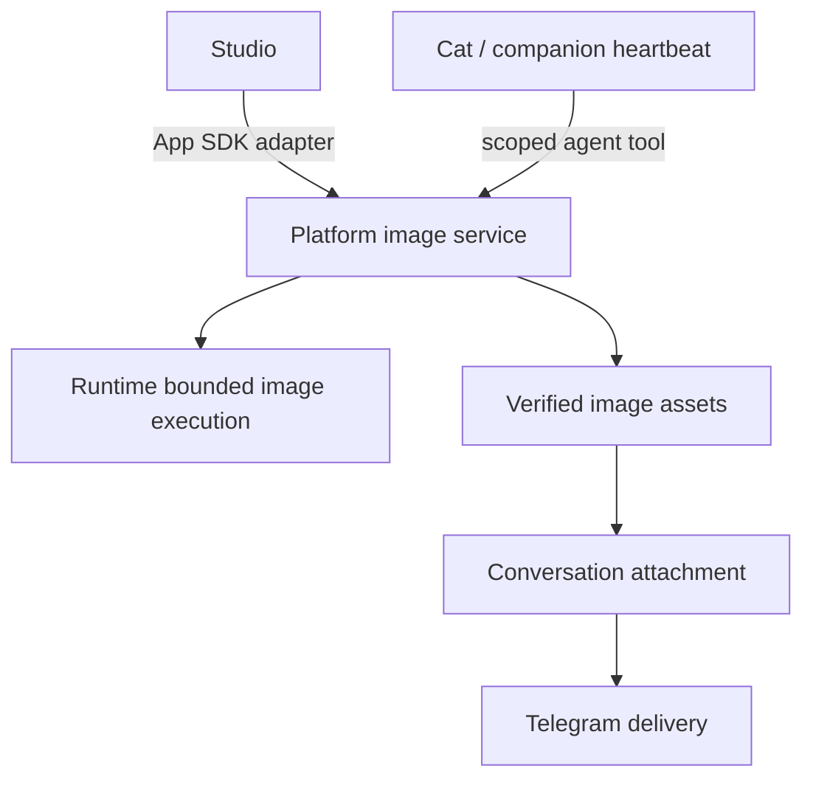

# ADR-136: Share controlled image capabilities between Cats and Studio

## Status

Accepted for implementation — 2026-10-23。owner 已要求依本規劃實作完整 golden path，
完成必要版本與 releases，包含 Desktop standard preview。後續澄清共用對象是
Studio，這次不改 Usage。功能、升級及發布驗收完成前不標成已交付。
規格：[SPEC-128](../specs/SPEC-128-shared-image-service-and-controlled-cat-generation.md)。
計畫：[PLAN-121](../plans/PLAN-121-shared-image-service-and-controlled-cat-generation.md)。

## Context

Implementation rebaseline：開始實作時 Platform 已為 SDK 1.7.0，Runtime 與 Studio
已接 image contract 2（Grok／Muse／Codex／Antigravity profiles、JPEG／PNG）。以下原始 schema 1
敘述保留規劃背景；實作保護目前兩種 App SDK contract，使用 Runtime 已宣告的
profile，不能將已交付的 contract 2 降回 schema 1。修圖仍為另外的操作擴充。

使用者定義的陪伴 golden path 包含：Cat 偶爾決定生圖，經受控執行取得圖片，再傳到
自己的 Telegram 私訊。只會從相簿挑既有圖片不足以完成這條路徑。

目前 Runtime 提供 bounded Grok 生圖；Platform 的 App 圖片服務管理工作、原檔與
Core task/run/artifact；Studio 透過公開 SDK 使用它。現有服務以 App/account 為
授權與資料範圍。陪伴心跳及相簿傳圖已實作，Cat 呼叫共用圖片服務尚未接通。
Studio 的修圖／合成與多 provider 是另外的擴充規劃，不是現有能力。

若 Cat 必須呼叫 `cats.studio`，就會讓 Runtime 已提供的共同執行能力跟著 Studio
的安裝與停用改變。直接借用 Studio App 身分則會破壞既有權限與資料隔離。

## Decision

### 1. 兩種入口使用同一個 Platform 圖片服務

Platform 抽出共同的 admission、工作狀態、冪等、收集及資產管理。App SDK adapter
保留既有 App/account/version/digest 驗證；Cat adapter 從受信的 session／對話脈絡
取得 Cat 身分與授權。兩者走同一個執行本體，不建立第二個 provider runner。

這是已證明有兩個消費者的圖片能力抽取；不擴建通用 App 執行框架或新的插件系統。

### 2. 能力、角色與 App 安裝分開判斷

Cat 能否生圖取決於可用 Runtime profile、Cat 的有效授權與執行前限制。Boss Cat
身分不自動授權，普通陪伴貓也可被授權。Studio 可選裝；未安裝不撤銷 Cat 的獨立
授權，安裝或啟用 Studio 也不替任何 Cat 授權。

App 仍可提供自己的獨有服務與工具。Studio 的模板或專有多步流程若未來由 App
實作，Cat 透過明確 App 工具依賴它是合理的；共同 provider 執行不因此移回 App。

### 3. 共同資產不等於共同可讀

每筆工作記錄 account、initiator（App 或 Cat）、來源、政策快照及 Runtime receipt
對應。資產由 Platform 保存，但讀取／引用仍需 scope 或明確 sharing grant。
Studio 不會因為使用同一服務就自動列出所有 Cat 圖片，Cat 也不能讀取其他 App 作品。

App 停用／移除只撤銷該 App 的能力並處理其發起的工作；Cat 停用／政策撤銷處理
該 Cat 的工作與待送訊息。已保存資產保留與刪除依 provenance、引用及 owner 意圖，
不因卸載 Studio 就刪掉 Cat 的作品。

### 4. 主動產圖與傳送各有授權

主動產圖預設關閉。owner 可對指定 Cat 預先授予有限次數、間隔、時段、target 與
期限；一般文字心跳不暗含圖片額度。執行前持久化預算預留，併發及重啟不能繞過。
次數是媒體執行上限，不是 provider 精確金額承諾。

傳送另檢查 owner、對話、有效 Telegram binding 與輸出權限。兩種權限都不接受
模型自述、prompt 或 Boss 角色代替。已授權的背景流程不逐張重問 owner。

### 5. 一次產圖、獨立送達

先保存同一個 request、政策預留與 Runtime ID；結果不明時只查原執行，不另生圖。
圖片驗證保存後以 asset reference 附到原對話，並建立 durable delivery intent。
傳送重試沿用同一張圖。Telegram 回應不明時保留 uncertain，不宣稱 exactly-once，
也不自動盲目重送。送達失敗不回滾已完成的產圖。

### 6. Runtime 納入契約與相容性驗證，第一階段不預設改 API

第一階段只沿用既有 Grok／單張／JPEG／1:1 的 Runtime HTTP 契約及限制。
Runtime 不負責 Cat、App 安裝、owner 預算或 Telegram，也不新增 Studio 專用執行路徑。

Cat 的聊天回合和圖片執行可能競爭同一 provider singleton／worker pool。必須驗證
tool submission 不等待另一個被自己持有的資源，並能在回合結束後繼續同一 job。
做不到時記錄 blocked 的精確前提，提出最小 Runtime successor；不得放寬 execution
guardrail、直接借聊天原生 image tool 或以增加容量冒充修復。

修圖、多 provider、PNG 或新 options 若改變 Runtime 契約，沿用 Apps PLAN-006 的
跨 repository contract 工作，不藉本提案宣稱已完成。

### 7. Studio 先保持公開契約

現有 Studio SDK 的方法、payload、資料隔離與可讀歷史保持。Platform 在內部改成
共用服務 adapter。SDK 1.8 新增 `media.images`，由 manifest SDK floor 協商；本次
Studio consumer 切換此 namespace，但不增加自己的生圖 server 或 agent tool 宣告。
新圖片操作及「讓 Studio 看見 Cat 作品」各自需要明確的新契約。

### 8. 實作落點與恢復證據

Cat 政策／預留／傳送 intent 使用獨立 SQLite ledger；既有 App Core metadata 與原圖
不搬移。兩種 caller 委派同一個 image executor。Cat host 以受控 session MCP 交付
generate/status，模型不能選擇 scope、source session、provider configuration 或收件人。

Runtime 的最小擴充是原 Cat turn 的明確完成觀察與 idle source resource handoff：
不搶其他 session，等全部 owned process/helper 真正停止才執行圖片工作。未知回合回執
不釋放 held admission。Telegram 另用 durable claim 與完整 dispatch-time 授權；
unknown delivery 只可明確重送原圖或停止後續傳送，不能冒充送達／未送達證據。

## Consequences

### Positive

- Cat 與 Studio 共用工作、原檔、冪等及 Runtime 防護，不依賴 UI 是否安裝。
- Cat 可有有限的背景生圖能力，同時維持 App/account 隔離。
- 生圖與送達的失敗各自恢復，避免 Telegram 故障造成再次生圖。

### Negative

- 需要共同 execution 型別與兩種 admission adapter；既有 App 資料保留原 scope 與位置。
- 新增 Cat agent tool delivery、持久預算與圖片 delivery intent 的整合工作。
- 原生 provider 的資源競爭需要 Runtime handoff 與每個實際 tuple 的驗證。

### Neutral

- Studio 仍是完整可選 App；本決策不將所有 App 降為 Platform 的 renderer。
- 既有相簿傳圖與文字心跳繼續使用各自的授權，不隱性增加生圖。
- 本方案已授權實作；驗證／發布狀態以 PLAN-121 為準，不以有程式碼代替 live acceptance。

## Alternatives Considered

| 方案 | 評估 |
| --- | --- |
| Cat 呼叫 Studio App 工具 | 適合 App 獨有流程；共同 Runtime 生圖會多出不必要的安裝及生命週期依賴 |
| Cat 直接呼叫 Runtime 或聊天內建 image tool | 會繞過 Platform 的 caller scope、預算及一致的資產／送達紀錄 |
| Cat 冒用 Studio App scope | 混淆授權與工作歸屬，停用／移除也無法正確處理 |
| 為 Cat 複製一套圖片服務 | 會讓同一執行、重啟及圖片驗證規則分叉 |

## References

- [ADR-120: App image jobs](120-scope-app-image-jobs-and-assets.md)
- [ADR-125: Complete Apps](125-own-multiple-frontends-and-backends-in-one-app.md)
- [SPEC-119: Existing App images](../specs/SPEC-119-app-image-generation.md)
- [SPEC-124: Companion life loop](../specs/SPEC-124-alive-companion-life-loop.md)
- [Runtime SPEC-033](../../../cats-runtime/docs/specs/SPEC-033-bounded-image-generation.md)
- [Apps SPEC-006](../../../cats-apps/docs/specs/SPEC-006-studio-image-workspace.md)

*Proposed: 2026-10-23. Documentation only; implementation review pending.*
