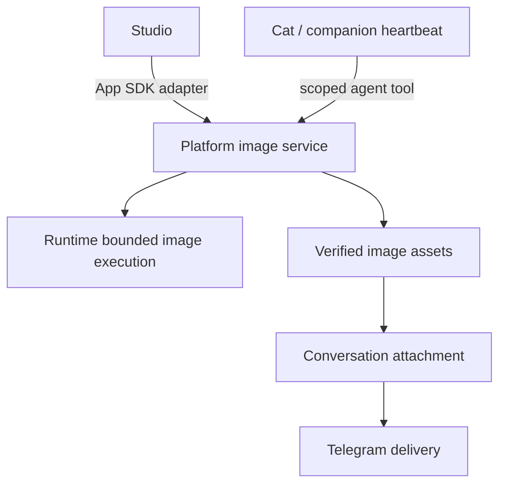

# ADR-136: Share controlled image capabilities between Cats and Studio

## Status

Accepted for implementation — 2026-10-23. The owner asked to implement the complete golden
path according to this plan, completing the necessary versions and releases, including the
Desktop standard preview. It was later clarified that the shared party is Studio, and Usage is
not changed this time. It is not marked as delivered until feature, upgrade and release
acceptance are complete.
Spec: [SPEC-128](../specs/SPEC-128-shared-image-service-and-controlled-cat-generation.md).
Plan: [PLAN-121](../plans/PLAN-121-shared-image-service-and-controlled-cat-generation.md).

## Context

Implementation rebaseline: when implementation started, Platform was already at SDK 1.7.0,
and Runtime and Studio were already on image contract 2 (Grok / Muse / Codex / Antigravity
profiles, JPEG / PNG). The original schema 1 description below is kept as planning
background; the implementation protects the two current App SDK contracts, uses the profiles
Runtime has already declared, and must not downgrade the delivered contract 2 back to
schema 1. Image editing remains a separate operation extension.

The user's companion golden path includes: a Cat occasionally decides to generate an image,
gets the picture through controlled execution, and sends it to his own Telegram DM. Only
picking existing images from the album is not enough to complete this path.

Runtime currently provides bounded Grok image generation; Platform's App image service
manages work, original files and Core task/run/artifact; Studio uses it through the public
SDK. The existing service takes App/account as the authorization and data scope. The
companion heartbeat and album picture sending are already implemented, but a Cat calling the
shared image service is not yet connected. Studio's image editing/compositing and
multi-provider support are separate extension plans, not existing capabilities.

If a Cat had to call `cats.studio`, the common execution capability Runtime already provides
would change with Studio's installation and disabling. Borrowing the Studio App identity
directly would break the existing permission and data isolation.

## Decision

### 1. Both entries use the same Platform image service

Platform extracts the common admission, job state, idempotency, collection and asset
management. The App SDK adapter keeps the existing App/account/version/digest verification;
the Cat adapter obtains the Cat identity and authorization from the trusted session/
conversation context. Both go through the same execution body, and no second provider runner
is created.

This is an extraction of an image capability already proven to have two consumers; it does
not build out a general App execution framework or a new plugin system.

### 2. Capability, role and App installation are judged separately

Whether a Cat can generate images depends on the available Runtime profile, the Cat's
effective authorization and the pre-execution limits. Boss Cat identity does not authorize
automatically, and an ordinary companion Cat can also be authorized. Studio is optionally
installable; not installing it does not revoke a Cat's independent authorization, and
installing or enabling Studio does not authorize any Cat.

An App can still provide its own unique services and tools. If Studio's templates or
proprietary multi-step flows are later implemented by the App, it is reasonable for a Cat to
depend on them through an explicit App tool; common provider execution does not move back
into the App because of that.

### 3. Shared assets are not shared readability

Each job records the account, initiator (App or Cat), source, policy snapshot and the mapping
to the Runtime receipt. Assets are stored by Platform, but reading/referencing still needs a
scope or an explicit sharing grant. Studio does not automatically list all Cat images just
because it uses the same service, and a Cat cannot read the works of other Apps.

Disabling/removing an App only revokes that App's capability and handles the jobs it
initiated; disabling a Cat or revoking its policy handles that Cat's jobs and pending
messages. Retention and deletion of stored assets depend on provenance, references and the
owner's intent; uninstalling Studio does not delete a Cat's works.

### 4. Proactive generation and delivery each have authorization

2026-10-27 owner correction: the image generation service has no time-window restriction,
including proactive images. Rhythm only decides when the life loop triggers proactive
interaction; the image service does not depend on rhythm, sleepUntil or life-loop enablement,
and has no separate image-generation window. Turns already started and jobs already accepted
may continue calling tools, generating and delivering. Cat/conversation disabled or archived,
account, binding, manual/proactive mode, policy expiry, quota and interval must still be
verified; "asleep" is not a revocation of image-generation authorization. The earlier
decision that retained a "proactive image-generation window" is void.

Proactive generation is off by default. The owner can pre-grant a specified Cat a limited
count, interval, target and expiry; an ordinary text heartbeat does not imply an image
quota. A durable budget reservation is persisted before execution, and concurrency and
restarts cannot bypass it. The count is a media execution cap, not a promise of exact
provider cost.

Delivery separately checks the owner, conversation, valid Telegram binding and output
permission. Neither permission accepts model self-description, a prompt or the Boss role as a
substitute. An authorized background flow does not re-ask the owner for each image.

### 5. One generation, independent delivery

First persist the same request, policy reservation and Runtime ID; when the result is unknown,
only query the original execution and do not generate another image. After the image is
verified and stored, attach it to the original conversation as an asset reference and create a
durable delivery intent. Delivery retries reuse the same image. When the Telegram response is
unknown, keep it as uncertain, do not claim exactly-once, and do not automatically resend
blindly. A delivery failure does not roll back an already completed generation.

### 6. Runtime takes the contract and compatibility verification; Stage 1 does not assume an API change

Stage 1 only reuses the existing Grok / single-image / JPEG / 1:1 Runtime HTTP contract and
limits. Runtime is not responsible for Cats, App installation, owner budget or Telegram, and
adds no Studio-specific execution path.

A Cat's chat turn and the image execution may compete for the same provider singleton /
worker pool. It must be verified that tool submission does not wait on another resource it
holds itself, and that the same job can continue after the turn ends. If this cannot be done,
record the exact blocked precondition and propose the minimal Runtime successor; the execution
guardrail must not be loosened, the native chat image tool must not be borrowed directly, and
adding capacity must not pass as a fix.

If image editing, multi-provider, PNG or new options change the Runtime contract, they follow
the cross-repository contract work of Apps PLAN-006, and this proposal does not claim it is
complete.

### 7. Studio keeps its public contract first

The methods, payload, data isolation and readable history of the existing Studio SDK are
kept. Platform switches internally to the shared-service adapter. SDK 1.8 adds
`media.images`, negotiated by the manifest SDK floor; this time the Studio consumer switches
to that namespace, but adds no image-generation server or agent tool declaration of its own.
New image operations and "let Studio see the Cats' works" each need an explicit new contract.

### 8. Implementation placement and recovery evidence

Cat policy / reservation / delivery intent use a separate SQLite ledger; the existing App
Core metadata and original images are not moved. Both callers delegate to the same image
executor. The Cat host delivers generate/status through a controlled session MCP, and the
model cannot choose the scope, source session, provider configuration or recipient.

Runtime's minimal extension is the explicit completion observation of the original Cat turn
and the idle source resource handoff: it does not grab other sessions, and runs the image job
only after all owned processes/helpers have actually stopped. An unknown turn receipt does not
release the held admission. Telegram additionally uses a durable claim and complete
dispatch-time authorization; unknown delivery can only explicitly resend the original image or
stop further delivery, and cannot pass as evidence of delivered/not delivered.

## Consequences

### Positive

- Cat and Studio share jobs, original files, idempotency and Runtime guards, regardless of
  whether the UI is installed.
- A Cat can have a limited background image-generation capability while App/account isolation
  is maintained.
- Generation and delivery failures recover independently, so a Telegram outage does not cause
  another image generation.

### Negative

- Common execution types and two admission adapters are needed; existing App data keeps its
  original scope and location.
- Integration work is added for Cat agent tool delivery, the durable budget and the image
  delivery intent.
- Resource competition in native providers needs the Runtime handoff and verification of each
  actual tuple.

### Neutral

- Studio is still a full optional App; this decision does not reduce all Apps to a Platform
  renderer.
- The existing album picture sending and the text heartbeat keep using their own
  authorizations, and do not implicitly add image generation.
- This plan is authorized for implementation; the verification/release state follows
  PLAN-121, and having code does not replace live acceptance.

## Alternatives Considered

| Option | Evaluation |
| --- | --- |
| A Cat calls Studio App tools | Fits App-unique flows; common Runtime image generation would gain unnecessary installation and lifecycle dependencies |
| A Cat calls Runtime or the chat's built-in image tool directly | Bypasses Platform's caller scope, budget and consistent asset/delivery records |
| A Cat impersonates the Studio App scope | Confuses authorization and job ownership, and disable/remove cannot be handled correctly |
| Duplicate an image service for Cats | Forks the rules for the same execution, restart and image verification |

## References

- [ADR-120: App image jobs](120-scope-app-image-jobs-and-assets.md)
- [ADR-125: Complete Apps](125-own-multiple-frontends-and-backends-in-one-app.md)
- [SPEC-119: Existing App images](../specs/SPEC-119-app-image-generation.md)
- [SPEC-124: Companion life loop](../specs/SPEC-124-alive-companion-life-loop.md)
- [Runtime SPEC-033](../../../cats-runtime/docs/specs/SPEC-033-bounded-image-generation.md)
- [Apps SPEC-006](../../../cats-apps/docs/specs/SPEC-006-studio-image-workspace.md)

*Proposed: 2026-10-23. Documentation only; implementation review pending.*
