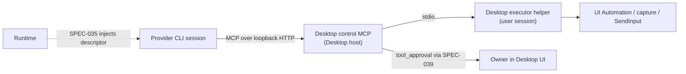

# ADR-141: Host a consented desktop control MCP for provider sessions

## Status

Proposed — 2026-10-29。只有文件，未授權實作；SPEC／PLAN 待本提案接受後另立。

## Context

Owner 想讓 Cats 起的 agent 能像 hosted computer use 一樣，看見並操作使用者電腦上的
原生 app。目前的狀況：

- **Provider 原生的 computer use 在這裡用不到。** Runtime 在本機啟動 Claude Code
  2.1.312。Windows 上 Claude Code 的 computer use 走雲端 session 加上 desktop app 的
  `remote-devices` bridge，需要伺服器注入的 session id；本機啟動不符合任何一個
  啟用條件（[Runtime 研究](../../../cats-runtime/docs/research/2026-10-28-claude-computer-use-remote-devices-gate.md)）。
  Codex 的桌面 helper 在 Runtime 託管的 session 裡也沒有可用證據
  （[Codex 研究](../../../cats-runtime/docs/research/2026-10-28-codex-host-capability-gaps.md)）。
  SPEC-039 因此把 Claude 的 computer use 回報為 `unavailable`。
- **開發者 skill 已經證明作業系統介面夠用。** `desktop-ui-automation` 用
  UI Automation、`CopyFromScreen`、`SendInput` 讀取和操作視窗；
  [PR #336](https://github.com/cats-inc/cats-platform/pull/336) 補上有防護的
  點擊與剪貼簿。但它是 agent 自己跑 PowerShell：每個動作在核准畫面上都是一段
  shell 指令，防護也能被 agent 改寫指令繞過，而且只有能跑 shell 的 CLI 用得到。
- **交付與核准的管道已經存在。** Runtime SPEC-035 讓 host 自己跑 loopback HTTP MCP
  server，再把描述交給 Runtime 注入 CLI；Platform 已用這個方式交付 Cat 工具
  （[ADR-136](136-share-controlled-image-capabilities-between-cats-and-studio.md) §8）。
  SPEC-039 的 Claude 對應規則寫明：
  「Session MCP tools are pre-approved only without a policy or with explicit
  `never`.」有明確 policy 時，每次 MCP 工具呼叫都會變成 `tool_approval`，經由
  Platform 的互動引擎（[PLAN-124](../plans/PLAN-124-provider-session-interactions-and-capability-visibility.md)）問使用者。

缺的是一個由 Cats 自己提供、能跨 CLI 使用、而且同意流程完整的桌面控制能力。

## Decision

### 1. Desktop host 提供 session MCP，Runtime 只負責注入

Desktop host 以 SPEC-035 的 `mcpServers` 描述（`transport: 'http'`、loopback URL、
bearer token）交給 Runtime 注入。Runtime 不 host 這個 server：Runtime 可能經由 peer
路由或在其他機器執行，由它 host 會操作到錯誤的桌面。Executor 必須以使用者身分、
不提權，跑在使用者的互動桌面（`WinSta0\Default`）上；Desktop host 本來就符合。

### 2. 第一個消費者只有 Desktop

本 ADR 只決定 Desktop。Bots 是另一個獨立消費者，要在 cats-bots 另立 ADR 採用。
Executor 與工具定義不引用 Platform 專屬模組，等 Bots 真的採用時再抽成共用套件，
落點屆時決定；遵循 ADR-136「兩個實際消費者才抽取」的原則，不預先放進 Runtime。

### 3. 只注入符合條件的 session

同時符合以下條件才注入：

- 使用者在 Desktop 設定中開啟桌面控制（預設關閉），並對該對話啟用。
- Session 套用明確的 `on-request` 或 `untrusted` policy，並協商了互動 host。
  `skip`、`never` 或沒有 policy 的 session 一律不注入，因為它們的 session MCP
  工具會被預先核准。
- 回合是 owner 在本機 Desktop 發起的。遠端入口（[ADR-139](139-manage-one-desktop-remote-ingress.md)）
  與 life loop 心跳（[ADR-127](127-keep-companion-cats-alive-with-a-platform-owned-life-loop.md)）
  發起的回合在第一階段不注入。

### 4. 三層同意，加上不受授權影響的排除

- **全域開關**：預設關閉。
- **逐 app 授權**：以可執行檔身分（路徑加簽章發行者）識別，不用視窗標題；標題會
  依語系改變，也可能重複。授權只在該 session 有效。觀察類工具同樣需要授權。
- **逐次核准**：輸入類工具每次都走 `tool_approval`。只有在 provider 提供
  `addRules` 建議時，才能選「本 session 內允許」；永久規則不轉送（SPEC-039）。

以下限制由 executor 強制，授權也無法解除：

- Cats Desktop 自己的視窗：agent 不能點自己的核准對話框。
- UI Automation 標記為 `IsPassword` 的欄位：不輸入。
- UAC 與安全桌面：一般輸入本來就做不到，也不嘗試繞過。
- 終端機與 IDE：只能觀察。對它們輸入等於取得 shell，shell 已有 `command_approval`。
- 瀏覽器：只能觀察。網頁操作用既有的 browser integration（`--chrome`）。

### 5. 只擷取已授權的視窗

截圖使用 Windows Graphics Capture 或 `PrintWindow` 這類「擷取單一視窗」的介面。
Skill 以視窗範圍做 `CopyFromScreen`，會把疊在上面的其他視窗一起拍進去；產品不能這樣
做。因此不需要像 Claude 那樣在操作期間隱藏其他視窗，使用者可以繼續用電腦。
截圖只送給該 session 的 provider，Platform 預設不保存。

### 6. Owner 必須在場，隨時能停止

- Session 持有桌面控制時，Desktop 顯示常駐提示（系統匣狀態與畫面提示）與停止鍵。
  停止會立即撤銷該 session 的授權，並中止進行中的動作。
- 螢幕鎖定時暫停。偵測到 owner 在 N 秒內有鍵盤或滑鼠輸入時（`GetLastInputInfo`），
  輸入類動作暫停並回報，不搶焦點；N 由 SPEC 決定。

### 7. Executor 是常駐 helper，不是每次啟動 PowerShell

Executor 是 Desktop host 管理的常駐 helper 程序，透過 stdio 傳 JSON。不採用每個
動作啟動一次 PowerShell：每次都要重新編譯 `Add-Type`，延遲高；而且 agent 啟動的
PowerShell 曾被 Defender 攔截（skill 的 Windows reference 記錄的 Junie 事件）。
PR #336 的 C# 防護邏輯是起點：截圖綁定、視窗未移動、未被遮蔽、游標落點驗證、
按鍵狀態檢查。實作語言與簽章由 SPEC 決定。

### 8. 工具分兩階段

- **A 觀察**：`list_windows`、`screenshot_window`、`read_ui`（UI Automation 名稱、狀態、文字）。
- **B 操作**：`click`、`type_text`、`key`、`scroll`、剪貼簿讀寫、`invoke_element`（UIA pattern）。

A 的同意介面要先在真實桌面上跑過並通過驗收，B 才開始實作。第一階段只做 Windows，
其他作業系統另行決定。

### 9. 能力回報分開

Runtime 的 computer use 欄位維持 provider 原生的狀態（Claude on Windows 為
`unavailable`）。Cats 桌面控制在 SPEC-039 中是 `session-injected` 的 MCP server，
Platform 在能力面板上將它列為 Cats 自己的能力，與 provider 原生能力分開。本 ADR
不要求 Runtime 改變欄位定義。

## Consequences

### Positive

- 任何支援 session MCP 的 CLI 都能用同一套能力，不受 provider 原生功能限制。
- 核准畫面顯示有意義的動作（哪個 app、哪個位置、輸入什麼），不是 PowerShell 指令。
- 防護在 executor 內強制，agent 無法繞過。
- 單一視窗擷取，不打斷使用者，也不外洩未授權的視窗。

### Negative

- Desktop 多一個常駐 helper，需要打包、簽章與防毒相容驗證。
- 需要新的設定、授權、提示與停止介面，以及對應的狀態管理。
- 逐次核准讓多步驟操作變慢；「本 session 內允許」的範圍要謹慎設計。
- 自繪介面或 UIA 資訊很少的 app，只能靠截圖和座標，可靠度較低。

### Neutral

- 開發者 skill 繼續作為驗收與除錯工具，不交付給產品 session。
- Bots 要用時另立 ADR；屆時抽取共用套件。
- Provider 日後若在本機開放原生 computer use，兩者並存，由 owner 選用。

## Alternatives Considered

| 方案 | 評估 |
| --- | --- |
| 把 skill 交付進 session（runtime-skills） | 核准畫面是原始 PowerShell，防護可被改寫，只有能跑 shell 的 CLI 能用 |
| 依賴 provider 原生 computer use | Windows 上本機啟動的 Claude Code 與 Codex 都拿不到（見兩份 Runtime 研究） |
| 由 Runtime host 這個 MCP | Runtime 可能經 peer 路由或在遠端，會操作到錯誤的桌面；也不符合 SPEC-035 的分工 |
| 每個動作啟動一次 PowerShell | 編譯延遲高，且曾被 Defender 攔截 |
| 全螢幕截圖並隱藏其他視窗 | 打斷使用者；單一視窗擷取可以達到相同的隱私目的 |
| 採用第三方 Windows MCP server | 同意模型與 SPEC-039 互動不相容，且增加供應鏈風險 |

## References

- [Runtime research: Claude Code computer use gate](../../../cats-runtime/docs/research/2026-10-28-claude-computer-use-remote-devices-gate.md)
- [Runtime research: Codex host capability gaps](../../../cats-runtime/docs/research/2026-10-28-codex-host-capability-gaps.md)
- [Runtime SPEC-035: Session MCP servers](../../../cats-runtime/docs/specs/SPEC-035-session-mcp-servers.md) /
  [ADR-044](../../../cats-runtime/docs/decisions/044-configure-session-mcp-servers-for-provider-clis.md)
- [Runtime SPEC-039: Provider session capabilities and interactions](../../../cats-runtime/docs/specs/SPEC-039-provider-session-capabilities-and-interactions.md) /
  [ADR-048](../../../cats-runtime/docs/decisions/048-bridge-provider-interactions-and-report-effective-session-capabilities.md)
- [SPEC-132: Provider session interactions](../specs/SPEC-132-provider-session-interactions-and-capability-visibility.md) /
  [PLAN-124](../plans/PLAN-124-provider-session-interactions-and-capability-visibility.md)
- [ADR-136: Shared controlled image capabilities](136-share-controlled-image-capabilities-between-cats-and-studio.md)
- [ADR-139: Desktop remote ingress](139-manage-one-desktop-remote-ingress.md)
- [ADR-127: Companion life loop](127-keep-companion-cats-alive-with-a-platform-owned-life-loop.md)
- [Bots PLAN-004: Provider interactions](../../../cats-bots/docs/plans/PLAN-004-provider-interactions-and-tool-visibility.md)
- [desktop-ui-automation skill](../../skills/desktop-ui-automation/SKILL.md) /
  [PR #336](https://github.com/cats-inc/cats-platform/pull/336)

*Proposed: 2026-10-29. Documentation only; no implementation authorized.*
