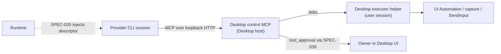

# ADR-141: Host a consented desktop control MCP for provider sessions

## Status

Accepted — 2026-10-29. The owner accepted this direction; implementation is not yet
authorized. Spec: [SPEC-133](../specs/SPEC-133-desktop-control-session-mcp.md).
Plan: [PLAN-126](../plans/PLAN-126-desktop-control-session-mcp.md).

Amended the same day: the owner wants desktop control in both Cats Desktop and Cats
Bots, implemented separately in each, with no shared package (§2). The Bots decision is
[Bots ADR-005](../../../cats-bots/docs/decisions/005-give-the-bot-owner-consented-desktop-control.md).

Placement: "Desktop host" in this ADR includes the Desktop-managed Platform server. The
MCP endpoint sits on the Platform server's internal listener, like `cat-image-tools`, and
the Platform server starts the executor helper from a path the Desktop host provides.
SPEC-133 has the details.

## Context

The owner wants agents that Cats starts to see and operate the owner's native apps, the
way hosted computer use does. Today:

- **Provider-native computer use is out of reach.** Runtime launches Claude Code 2.1.312
  as a local process. On Windows, Claude Code's computer use goes through a remote
  session plus the desktop app's `remote-devices` bridge, which needs a server-injected
  session id; a local launch meets none of its enabling conditions
  ([Runtime research](../../../cats-runtime/docs/research/2026-10-28-claude-computer-use-remote-devices-gate.md)).
  There is no evidence that Codex's desktop helper works in Runtime-hosted sessions
  either ([Codex research](../../../cats-runtime/docs/research/2026-10-28-codex-host-capability-gaps.md)).
  SPEC-039 therefore reports Claude's computer use as `unavailable`.
- **The developer skill shows the OS interfaces are enough.** `desktop-ui-automation`
  reads and operates windows through UI Automation, `CopyFromScreen` and `SendInput`;
  [PR #336](https://github.com/cats-inc/cats-platform/pull/336) added a guarded click and
  clipboard. But the agent runs the PowerShell itself: every action shows up as a shell
  command on the approval screen, the agent can rewrite the command to skip a guard, and
  only CLIs with a shell can use it.
- **Delivery and approval paths already exist.** Runtime SPEC-035 lets a host run its own
  loopback HTTP MCP server and hand Runtime a descriptor to inject into the CLI. Platform
  already delivers Cat tools this way
  ([ADR-136](136-share-controlled-image-capabilities-between-cats-and-studio.md) §8).
  SPEC-039's Claude mapping states: "Session MCP tools are pre-approved only without a
  policy or with explicit `never`." With an explicit policy, every MCP tool call becomes a
  `tool_approval` that Platform's interaction engine asks the owner about
  ([PLAN-124](../plans/PLAN-124-provider-session-interactions-and-capability-visibility.md)).

What is missing is a Cats-owned desktop control capability that works across CLIs and has a
complete consent flow.

## Decision

### 1. The host serves a session MCP; Runtime only injects it

The Desktop host hands Runtime a SPEC-035 `mcpServers` descriptor (`transport: 'http'`,
loopback URL, bearer token) to inject. Runtime does not host this server: Runtime can be
peer-routed or run on another machine, and a Runtime-hosted server would then operate the
wrong desktop. The executor must run as the user, unelevated, on the user's interactive
desktop (`WinSta0\Default`); the Desktop host already does.

### 2. Desktop and Bots implement it separately against one contract

Cats Desktop and Cats Bots both provide desktop control. Each implements its own MCP
server and native helper, with no shared package: Bots depend only on Runtime, not on
Platform (SPEC-132), and the owner chose not to put OS automation into Runtime or a new
repository.

To keep the two implementations from drifting, the "Cross-implementation contract" in
[SPEC-133](../specs/SPEC-133-desktop-control-session-mcp.md) is the common baseline: the
server name, tool names and schemas, error codes, exclusion categories, and the injection,
turn, grant and stop rules. The Bots SPEC refers to that contract; a change to it updates
both SPECs. Settings, grant UI, indicators and packaging follow each repository's own
surfaces.

### 3. Inject only into qualifying sessions

All of these must hold:

- The owner has turned desktop control on in Desktop settings (off by default) and enabled
  it for the conversation.
- The session runs an explicit `on-request` or `untrusted` policy with a negotiated
  interaction host. Sessions with `skip`, `never` or no policy are never injected, because
  their session MCP tools would be pre-approved.
- The owner started the turn locally in Desktop. Turns started through remote ingress
  ([ADR-139](139-manage-one-desktop-remote-ingress.md)) or by a life loop heartbeat
  ([ADR-127](127-keep-companion-cats-alive-with-a-platform-owned-life-loop.md)) are not
  injected in the first phase.

### 4. Three layers of consent, plus exclusions no grant can lift

- **Global switch**: off by default.
- **Per-app grant**: identified by executable identity (path plus signing publisher), not
  window title, since titles are localized and can repeat. A grant lasts only for that
  session. Observation tools need the grant too.
- **Per-action approval**: every input tool goes through `tool_approval`. "Allow for this
  session" is offered only when the provider suggests `addRules`; persistent rules are
  never forwarded (SPEC-039).

The executor enforces these regardless of grants:

- Cats Desktop's own windows: an agent must never click its own approval dialog.
- Elements UI Automation marks `IsPassword`: no input.
- UAC and the secure desktop: ordinary input cannot reach them, and nothing tries to
  work around that.
- Terminals and IDEs: observe only. Typing into them is a shell by proxy, and shell
  commands already have `command_approval`.
- Browsers: observe only. Web work uses the existing browser integration (`--chrome`).

### 5. Capture only the granted window

Screenshots use a single-window capture API such as Windows Graphics Capture or
`PrintWindow`. The skill's `CopyFromScreen` over the window's bounds also captures any
window lying on top of it; the product must not do that. With single-window capture there
is no need to hide other windows during control, as Claude does, and the owner can keep
using the computer. Screenshots go only to that session's provider, and Platform does not
store them by default.

### 6. The owner must be present and able to stop at any time

- While a session holds desktop control, Desktop shows a persistent indicator (tray state
  and an on-screen notice) with a stop control. Stopping immediately revokes that session's
  grants and aborts the action in progress.
- Actions pause while the screen is locked. When `GetLastInputInfo` shows owner keyboard or
  mouse input within N seconds, input actions pause and report it instead of competing for
  focus; SPEC-133 sets N.

### 7. The executor is a long-lived helper, not PowerShell per action

The executor is a long-lived helper process managed by the Desktop host, speaking JSON over
stdio. Starting PowerShell for every action is rejected: each start recompiles `Add-Type`,
which adds latency, and Defender has flagged agent-launched PowerShell before (the Junie
incident recorded in the skill's Windows reference). The C# guard logic from PR #336 is the
starting point: snapshot binding, an unmoved window, no covering window, cursor landing
verification and held-key checks. The implementation language and signing are SPEC scope.

### 8. Two tool phases

- **A, observe**: `list_windows`, `screenshot_window`, `read_ui` (UI Automation names,
  states and text).
- **B, act**: `click`, `type_text`, `key`, `scroll`, clipboard read and write,
  `invoke_element` (UIA patterns).

Phase B is implemented only after phase A's consent flow has run on a real desktop and
passed acceptance. The first phase covers Windows only; other operating systems are a
separate decision.

### 9. Report capabilities separately

Runtime's computer use field keeps the provider-native state (`unavailable` for Claude on
Windows). In SPEC-039 terms, Cats desktop control is a `session-injected` MCP server, and
Platform lists it in the capability panel as a Cats capability, separate from provider-native
ones. This ADR asks Runtime for no change to the field's definition.

## Consequences

### Positive

- Every CLI that supports session MCP gets the same capability, independent of provider
  features.
- Approval screens show meaningful actions (which app, where, what text), not PowerShell.
- Guards are enforced inside the executor, so the agent cannot bypass them.
- Single-window capture neither interrupts the owner nor leaks ungranted windows.

### Negative

- Desktop gains a long-lived helper that needs packaging, signing and antivirus checks.
- New settings, grant, indicator and stop UI, with the state behind them.
- Per-action approval slows multi-step work; the scope of "allow for this session" needs
  care.
- Custom-drawn apps or apps with little UIA information rely on screenshots and
  coordinates, which is less reliable.
- Two implementations: the native helper is built, signed and maintained twice, and
  contract changes must land on both sides.

### Neutral

- The developer skill remains an acceptance and debugging tool and is not delivered to
  product sessions.
- Bots decide their own settings, grant and stop surfaces, as long as they meet the shared
  contract.
- If a provider later offers native computer use to local sessions, both can coexist and
  the owner chooses.

## Alternatives Considered

| Alternative | Assessment |
| --- | --- |
| Deliver the skill into sessions (runtime-skills) | Approvals show raw PowerShell, guards can be rewritten, and only CLIs with a shell can use it |
| Rely on provider-native computer use | Locally launched Claude Code and Codex on Windows cannot reach it (see both Runtime research notes) |
| Let Runtime host this MCP | Runtime may be peer-routed or remote and would operate the wrong desktop; it also breaks SPEC-035's division of work |
| Start PowerShell for each action | High compile latency, and Defender has flagged it before |
| Full-screen capture while hiding other windows | Interrupts the owner; single-window capture meets the same privacy goal |
| Adopt a third-party Windows MCP server | Its consent model does not fit SPEC-039 interactions, and it adds supply-chain risk |
| Share one package (in Runtime or a new repository) | Avoids duplicate work; on 2026-10-29 the owner chose separate implementations held together by the shared contract |

## References

- [Runtime research: Claude Code computer use gate](../../../cats-runtime/docs/research/2026-10-28-claude-computer-use-remote-devices-gate.md)
- [Runtime research: Codex host capability gaps](../../../cats-runtime/docs/research/2026-10-28-codex-host-capability-gaps.md)
- [Runtime SPEC-035: Session MCP servers](../../../cats-runtime/docs/specs/SPEC-035-session-mcp-servers.md) /
  [ADR-044](../../../cats-runtime/docs/decisions/044-configure-session-mcp-servers-for-provider-clis.md)
- [Runtime SPEC-039: Provider session capabilities and interactions](../../../cats-runtime/docs/specs/SPEC-039-provider-session-capabilities-and-interactions.md) /
  [ADR-048](../../../cats-runtime/docs/decisions/048-bridge-provider-interactions-and-report-effective-session-capabilities.md)
- [SPEC-132: Provider session interactions](../specs/SPEC-132-provider-session-interactions-and-capability-visibility.md) /
  [PLAN-124](../plans/PLAN-124-provider-session-interactions-and-capability-visibility.md)
- [ADR-136: Shared controlled image capabilities](136-share-controlled-image-capabilities-between-cats-and-studio.md)
- [ADR-139: Desktop remote ingress](139-manage-one-desktop-remote-ingress.md)
- [ADR-127: Companion life loop](127-keep-companion-cats-alive-with-a-platform-owned-life-loop.md)
- [Bots PLAN-004: Provider interactions](../../../cats-bots/docs/plans/PLAN-004-provider-interactions-and-tool-visibility.md)
- [Bots ADR-005: Owner-consented desktop control](../../../cats-bots/docs/decisions/005-give-the-bot-owner-consented-desktop-control.md) /
  [SPEC-006](../../../cats-bots/docs/specs/SPEC-006-desktop-control-session-mcp.md)
- [desktop-ui-automation skill](../../skills/desktop-ui-automation/SKILL.md) /
  [PR #336](https://github.com/cats-inc/cats-platform/pull/336)

*Proposed and accepted: 2026-10-29. Implementation not yet authorized.*
