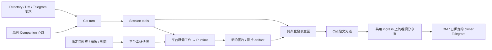

# ADR-151: Build Cat Profile Posts on Managed Media and Share Links

## Status

Proposed — 2026-11-11。依使用者要求先交付 ADR／spec／plan；本次沒有實作、
啟用公開連線、呼叫生成服務或發送訊息。產品目標已明確，以下是供實作採用的 PoC 設計。

- Spec: [SPEC-143](../specs/SPEC-143-cat-profile-posts-media-and-sharing.md)
- Plan: [PLAN-136](../plans/PLAN-136-cat-profile-posts-media-and-sharing.md)

## Context

使用者希望 Directory → 貓咪個人檔案 →「貼文」成為類似 Facebook 個人河道的內容首頁：
貓咪可以發文、編輯、刪文，附照片／影片，也能使用指定來源資料夾、大頭照、封面圖，
透過平台生成新的 AI 作品。具自主活動能力的 Companion 可以在心跳中創作及發表，
產生分享頁後透過 DM 或 Telegram 把連結傳給使用者。

具體示例：「我今天到巴黎了」，附上保留貓咪大頭照外觀、背景是巴黎鐵塔的 AI 圖片。
使用者優先要看見 PoC，不需要逐張圖片、逐篇貼文的審批流程。

目前已有個人檔案、文字發文工具、owner soft remove、內部 `cats://companion/v1/...`
參照、心跳、相簿及 Cat 圖片工作。但文字發文走單次 decision sidecar，媒體格只有空白
佔位；封面存於 renderer localStorage；圖片契約只接受 `image.generate`、零輸入圖片。
不能把這些基礎能力宣稱為已可執行參考圖合成、影片生成或公開貼文分享。
來源與外部連線依據見[現況筆記](../research/2026-11-11-cat-profile-publishing-baseline.md)。

## Decision

### 1. Directory 是唯一個人檔案入口；貼文以 Cat 為作者

沿用 ADR-150 的 `/entities/cats/:catId` 及原有頁首與分頁。
貼文採時間倒序、作者頭像與時間、內文、照片拼排／影片播放器、分享與更多操作。
使用者可從頁面請貓咪發文、管理來源與刪文；PoC 不新增「冒用 Cat 身分」的人類貼文編輯器。
一般 Cat 可在明確要求下發表；只有符合既有 Companion／自主活動條件的 Cat 會自動發文。
不以 Boss 身分、Work scope 或 Studio 安裝狀態作為發文前提。

沿用 `CompanionDerivedRecord` 作為 published post 的權威資料，不建立平行的 social feed
資料庫。保留 post id、內部參照與移除語意；增加有型別、可驗證的附件及作品來源資料。
來源資料夾只是素材庫，掃描及生成結果都不會自動變成公開貼文。

### 2. 以平台保存的媒體為共同基礎

來源資料夾、頭像與封面先由 host 解析為有 ID 的素材；使用時保存內容快照。
平台保存生成後的新檔案、縮圖／影片 poster、hash、原始素材關係與生成 job receipt。
生成不覆寫來源檔，也不自動更換 Cat 頭像或封面。

PoC 沿用 `life.photoFolder` 作為唯一來源目錄設定，UI 名稱擴為「來源資料夾（照片／影片）」。
手動創作讀取該設定不依賴 `life.enabled` 或作息；不另造第二個不同步的 directory 欄位。
封面轉為平台持久化資產，舊 localStorage 封面採可重試的一次性匯入。

Platform 持有產品工作、素材與發表；Runtime 持有 provider 執行與能力宣告。
擴充 ADR-136 的共同媒體服務，Studio 不成為依賴，也不複製 provider runner。
第一個完整示範需要真正帶參考圖的圖片轉換；文字描述大頭照不算完成。
影片屬於第二個必要交付切片：先做一個經驗證的短片生成 profile，接受圖片或從來源影片
擷取的明示影格。原生 video-to-video 編修可後續擴充，不能把取格再創作標成保留原影片動作。

### 3. Agent 使用結構化工具；Host 接續長時間工作

發文、讀取、修改、刪除、生成、分享、通知都經由既有受 session 約束的工具入口。
沿用 `companion.content.post.create` 的 domain operation，新的 MCP 名稱是它的介面；
原 decision sidecar 若仍服務既有 provider，也呼叫同一個 operation，不能雙重發文。
所有工具合成於該 session 的一個 `cats` server，不能為媒體再注入同名第二個 server。

生成工具立即回傳 job ID；agent 可以建立引用該 job 的待發表意圖。
Host 在媒體完成後自動完成貼文、分享及通知，無須第二次 model turn 輪詢。
generation、publication、share、notification 各有獨立結果；通知失敗不會重生圖片。
沿用 Runtime 的 originating-turn handoff，不能在佔住同一 provider 的 turn 內同步等待生成。

### 4. 一次設定後可自動執行，保留少量必要界線

每隻 Cat 的個人檔案提供來源、生成、自動發文與通知設定；優先重用既有 image policy、
自主活動及 Telegram owner binding。開啟自動發文後不再要求逐篇批准，明確的手動要求也
不等待心跳。既有授權、用量不被偷偷擴大；沒有設定時提供一個可一次儲存的 PoC 預設組合。

第一版只保留：Cat 操作自己的貼文、host 只讀指定素材、有限自動生成頻率、分享可撤銷、
訊息送到既有 owner 綁定。這些是執行邊界，不是新增多層角色、proposal queue 或審批產品。

### 5. 內部內容參照與外部分享網址各司其職

內部 DM 繼續使用 SPEC-086 的內容參照與預覽。新增
`/s/companion/{opaqueToken}` 唯讀 HTML 分享頁及它的媒體子路由，掛在既有 shared ingress；
不把完整 Desktop、一般 `/api/*` 或 Runtime listener 當作分享入口。
拿到網址的人可讀該篇文章與指定附件，無須建立 Cats 帳號；不公開素材資料夾或其他貼文。

優先使用既有 managed ngrok／external tunnel。Tailscale Serve 適合 tailnet 內閱讀；
Funnel 適合外部閱讀，PoC 可先走 external tunnel 設定，不等待完整 managed Funnel UI。
不新增第二條 tunnel 或常駐雲端服務。Cats 主機離線時分享頁無法服務；換 origin 後舊網域
不保證可用。分享刪除或撤銷立即停止新請求，已寄出的訊息、下載檔與第三方快取不能回收。

### 6. 先交付照片完整路徑，再完成影片

第一個可見里程碑是實際的巴黎 AI 圖文與可打開的分享連結，不等待留言、按讚、演算法
推薦或完整社群系統。第二個里程碑把相同管線接上實際短片產出與來源影片再創作。
只完成圖片不能把整份 spec 標為 implemented；未知 provider 能力必須明列未驗證。

## Consequences

- 重用現有個人檔案、工作、心跳、連線及傳輸，減少 PoC 的新基礎設施。
- 需要 Runtime 參考圖／影片能力擴充；這是實際依賴，不能用 UI 假資料填補。
- 需要封面與 companion snapshot 的可恢復升級，以及跨工作完成時的持久化去重。
- 本 ADR 補充 ADR-084 未定義的貼文模型、SPEC-086 未涵蓋的外部分享、ADR-136 的輸入媒體。
  ADR-150 的 Directory 所有權與 SPEC-137 的作息／退避仍成立。

## Alternatives Considered

| 選項 | 未採用原因 |
| --- | --- |
| 先只畫 Facebook 風格 mock feed | 無法驗證生成、發表與分享的真實閉環 |
| 每篇文章都建立 owner approval | 與使用者的 PoC 優先及自主活動目標不符 |
| 用聊天文字／`[photo: path]` 解析成完整發文協定 | 無穩定附件、job 與重試語意，且現有指令僅用於相簿傳圖 |
| 另建社群服務、雲端儲存或 Studio 專用 backend | 在第一個示範前增加不必要依賴 |
| 把素材目錄直接掛到 tunnel | 不能限制分享內容，也會失去作品版本與刪文撤銷語意 |

*Last updated: 2026-11-11*
