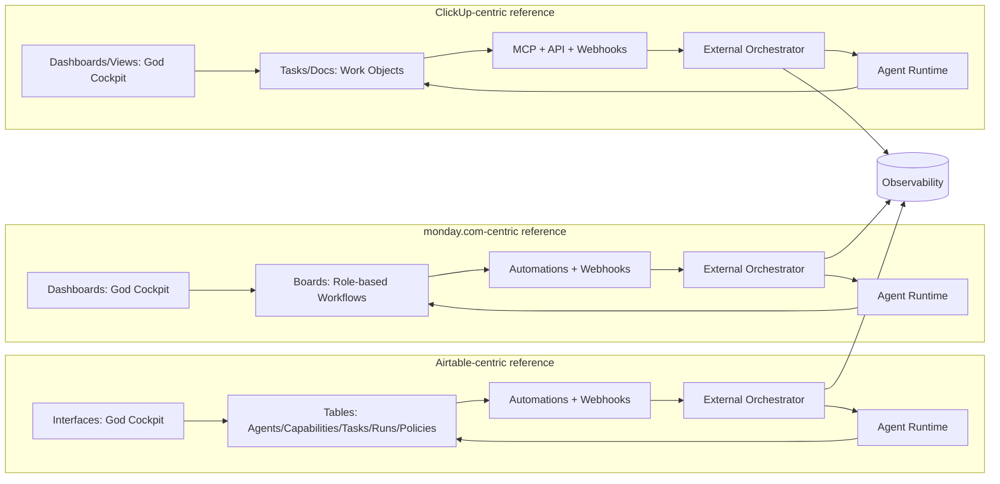
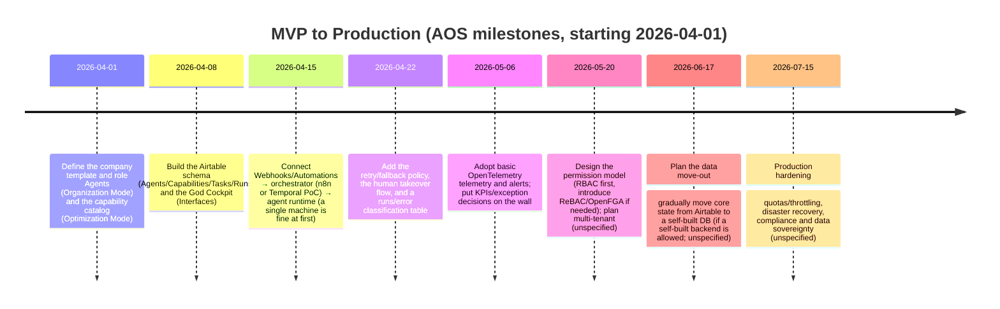

# AI-First One-Person / Zero-Person Digital Company Agent Operating System (AOS) Reference System Evaluation: Airtable vs monday.com vs ClickUp (as of 2026-04-01)

[Download research.md](sandbox:/mnt/data/research.md)

## Executive Summary
This report centers on the "one-person / zero-person digital company" scenario: from Day 1 the human user governs multiple AI Agents from a God perspective, normally looking only at a high-level Dashboard and taking over in person only for exceptions. The three candidate tools each represent a different "worldview": **Airtable is more of a data/state backbone**, **monday.com is more of a role/workflow cockpit**, and **ClickUp is more of a task/work-object hub**. Considering data model, event-driven integration, governance and agent-first capability together, the **single preferred reference system in this report is Airtable**; if you treat "workplace personification + Day-1 boss feeling" as the first priority, monday.com's cockpit/role narrative is the most worth copying; if you treat "agents directly operating work objects" as the first priority, ClickUp's MCP/AI interface is the strongest reference. The final recommendation is a layered architecture of **Role-framed (appearance) × Capability-powered (execution) × State-orchestrated (orchestration)**, using an external orchestrator/queue/observability to fill the native gaps all three have in reliable retries, long-running flows and observability. citeturn3search12turn0search17turn0search2turn4search22turn4search4

The tools evaluated are entity["company","Airtable","collaboration platform"], entity["company","monday.com","work management platform"] and entity["company","ClickUp","productivity platform"]; official support/developer documentation and 2024–2026 update entries are preferred as evidence (for example Webhooks/AI/permissions/audit/pricing and limits). citeturn0search0turn0search13turn0search6turn1search0turn1search1turn1search2

## Premises and Assumptions
**Specified target scenario**
- **User role**: a single human (God/Owner/Governor) who does not take part in day-to-day collaboration; the main interactions are the "high-level war room" and "exception decisions/takeover".
- **Executors**: multiple AI Agents (mainly A2A automatic collaboration), which can be personified by workplace culture as RD/PM/Growth/Sales/CS/Finance/HR and so on (to lower the cost of understanding).
- **Business scope**: centered on "software R&D and shipping", but the same governance view should extend to sales, marketing, HR, customer relations, operations, finance and so on.

**Key parameters not specified (this report marks them as "unspecified" and evaluates under reasonable assumptions)**
- **Budget** (unspecified): the acceptable monthly cap; preference for seat-based, bucket pricing, or credit-based (AI credits/usage) billing. citeturn1search0turn1search1turn1search2
- **User technical ability** (unspecified): whether data modeling, API/automation, DevOps and self-hosting skills are available. citeturn4search8
- **Whether a self-built backend is allowed** (unspecified): whether a self-built DB, queue, orchestrator and observability are allowed. citeturn4search22turn4search8turn4search4
- **Expected go-live time** (unspecified): the MVP launch target (for example 2 weeks / 1 month / 1 quarter).
- **Number of users** (unspecified): besides God, whether a few real people (contractors/accountants/legal/customers) will log in; whether AI agents must have "independent identities" and permissions. citeturn2search15turn2search13turn2search2
- **Compliance / data sovereignty needs** (unspecified): whether SSO/SCIM, audit log retention, data residency and multi-tenant isolation are needed. citeturn2search3turn2search19turn2search1turn1search14turn0search1

**Scoring method (0–10)**
- 10: native capability covers the AOS need to a large extent (a few plugins suffice).
- 7–9: satisfies the core, but needs external components to reinforce reliability/observability/governance.
- 4–6: more of a "reference / partial core"; to be AOS-like it needs large external systems to fill in.
- 0–3: highly mismatched with the AOS worldview.

## Overall Scores and Ranking
**Total score table (out of 100)**
(Scores correspond to the ten dimensions in the next section; the total is an equal-weight sum)

| Dimension | Airtable | monday.com | ClickUp |
|---|---:|---:|---:|
| Data model flexibility | 9 | 6 | 7 |
| workflow / orchestration | 6 | 5 | 5 |
| agent-first support | 7 | 8 | 9 |
| API / automation / webhook | 9 | 8 | 8 |
| Permissions and governance | 8 | 8 | 7 |
| observability and metrics | 5 | 5 | 5 |
| Scalability and cost estimation | 7 | 5 | 6 |
| Ease of onboarding and configurability | 7 | 9 | 7 |
| AI/LLM native integration | 8 | 8 | 9 |
| Ecosystem and third-party tools | 9 | 8 | 8 |
| **Total** | **75** | **70** | **71** |
| **Rank** | **1** | **3** | **2** |

The scores reflect overall fit as an "AOS reference system", not a general project-management tool comparison. Especially in your specified God-mode / background A2A scenario, **data and state** (an ontology/state machine that can carry multiple agents) usually decides success more than "how pretty the collaboration UI is". citeturn3search12turn0search0turn0search17turn0search2

## Ten Dimensions, One by One
Each dimension below includes: **a short comment, a quantitative score (0–10), key risks and limits, and suggested use cases**. To fit the premise of "one God + multiple agents running in the background", the suggested usage specifically notes the most reasonable division of labor for each tool within an AOS.

**Dimension 1: Data model flexibility (relational schema, transactional state)**
Airtable's core strength is that multiple tables and linked records (relation / foreign-key-like concepts) can directly model multi-entity state such as "Agents / Capabilities / Tasks / Runs / Policies / Assets". citeturn3search12turn3search4turn3search8
monday.com and ClickUp also have linking capabilities (Connect boards, Relationships), but lean toward "linking work objects to each other" rather than designing the whole company system as a database. citeturn3search5turn3search6

| Tool | Score | Short comment | Key risks and limits | Suggested use case |
|---|---:|---|---|---|
| Airtable | 9 | Multiple tables + linked records approximate relational modeling, suitable as the AOS state backbone. | Not a traditional RDBMS; high concurrency / strongly consistent transactions still need an external DB. | Put agents, tasks and run records all in records; use Interfaces for the God cockpit. |
| monday.com | 6 | Centered on board items, using Connect boards/Mirror for cross-board relations. | Relation flexibility and maintainability are below multi-table relations; multi-board sync is costly. | Suited to "department/process visualization"; should not be the sole source of truth. |
| ClickUp | 7 | Strong tasks + relationships/dependencies, suited to a universe of R&D and delivery work objects. | Inherently biased toward a task universe; awkward to carry ontology data such as CRM/finance. | Concentrate specs/issues/docs/deliverables here; move company governance data out to a data layer. |

**Dimension 2: workflow/orchestration capability (state machine, retry, fallback, dependency management)**
All three provide built-in automations, but most are "event trigger → action" workflows rather than durable state machines; if you want true retry/fallback/compensating transactions and long-running flows, you usually need an external orchestrator (for example Temporal's durable execution / built-in retries, timers, queues). citeturn3search1turn3search29turn4search22turn4search3

| Tool | Score | Short comment | Key risks and limits | Suggested use case |
|---|---:|---|---|---|
| Airtable | 6 | Automations + "Run a script" can do background steps; run history lets you trace usage/history. | Native conditional branching and automatic retry are limited; complex compensation flows are unfriendly. | Use as "trigger + state table"; leave reliable orchestration to an external orchestrator. |
| monday.com | 5 | Automations are quick to start; Dependencies/Connect boards make basic flows easy. | Complex state machines, long transactions and reliable retries still have to move outside. | Treat as a "visual workflow layer"; move the real A2A orchestration outside. |
| ClickUp | 5 | Dependencies/Relationships + API let agents place work decomposition and dependency management on tasks. | Still not a durable orchestrator; reliable retry/rollback needs external help. | Responsible for "work-object coordination and dependency representation"; move execution orchestration outside. |

**Dimension 3: agent-first support (modeling and execution interfaces that treat agents as first-class citizens)**
In its official 2026 announcement, monday.com explicitly states that AI Agents can sign up for free, get an API key immediately, and support MCP (Model Context Protocol), taking "agent as a participant inside the platform" a big step forward. citeturn0search17
ClickUp also provides an official MCP Server in its developer documentation, defining MCP as a secure standardized framework that lets external AI agents access ClickUp workspace objects (tasks/lists/docs and so on) in natural language / tool form. citeturn0search2turn0search6
Airtable's "agent" leans toward embedding in the data layer (Field agents automatically extract/analyze/generate data at the cell level), which is very suitable for background operation, but the semantics of an "agent identity lifecycle" usually have to be modeled yourself. citeturn0search4

| Tool | Score | Short comment | Key risks and limits | Suggested use case |
|---|---:|---|---|---|
| Airtable | 7 | AI can be embedded in fields/records, suited to a "background automated company". | Agent identity, delegation policy and multi-agent permission semantics mostly have to be built yourself. | Build the agent registry, capabilities and runs all as tables; execute in an external runtime. |
| monday.com | 8 | Officially brings AI agents into platform operation (signup/API key/MCP), the closest to a "digital employee" joining the company. | Still leans toward a human-organization context; agent billing/permission details need careful plan reading. | If you lead with "workplace role personification" and a Day-1 boss feeling, the UI/narrative is the most worth copying. |
| ClickUp | 9 | The official MCP Server lets agents access work objects such as tasks/docs, with a clear interface. | Agent-first strength is concentrated in the ClickUp object world; cross-cutting governance data still needs an external layer. | Treat as the standard reference and integration entry for "agents operating work objects". |

**Dimension 4: API / automation / webhook ecosystem (bidirectional integration, event-driven capability)**
Airtable provides a Webhooks API to notify base changes in real time (record added / field updated / view-change related). citeturn0search0turn0search8
monday.com's Platform API is GraphQL, and its webhooks documentation describes webhook URL verification and retry policies, which are critical for event-driven integration. citeturn0search13turn0search5
ClickUp's developer portal also lists the Public API, Webhooks, OAuth and MCP together. citeturn0search6

| Tool | Score | Short comment | Key risks and limits | Suggested use case |
|---|---:|---|---|---|
| Airtable | 9 | Webhooks + API make Airtable an event source and state store. | High event volume needs throttling/de-duplication/consistency; may need replication/queue. | Drive an external orchestrator with webhooks; Airtable records state. |
| monday.com | 8 | GraphQL gives high data-access flexibility; webhooks have platform-level verification/retry support. | Multi-product-line / multi-object schemas are more complex; permissions and token management must be rigorous. | Drive "department workflows" with platform events; an external runtime handles execution. |
| ClickUp | 8 | API + webhooks + OAuth + MCP are complete, best for pulling agents into the system. | Non-task governance data still needs an external layer; API limits/plan binding must be confirmed. | Use MCP/API for agents to read and write tasks/docs; an external DB records business state. |

**Dimension 5: Permissions and governance (RBAC, audit log, multi-tenant)**
Airtable's enterprise permissions describe several admin roles (such as Super Admin / Org Unit Admin / Integration Admin), and it has audit logs (including an API) and data residency (selectable regions in Enterprise Scale). citeturn2search15turn1search7turn2search3turn1search3
monday.com's permissions documentation says behaviors such as creating boards/docs, inviting, exporting, API tokens and automations can be controlled by user type (admin/member/viewer/guest); it also has custom roles and SCIM provisioning. citeturn2search13turn2search5turn2search1
ClickUp provides a management page for custom role permissions, and audit logs are in the Enterprise plan with a retention limit (the documentation example is 30 days). citeturn2search2turn1search14turn1search38turn1search6

| Tool | Score | Short comment | Key risks and limits | Suggested use case |
|---|---:|---|---|---|
| Airtable | 8 | Complete enterprise governance semantics (roles, SSO/SCIM, audit logs, data residency). | Most advanced governance is complete only in Enterprise; can be simplified in the MVP phase. | If you expect multi-tenant/compliance later, Airtable's governance model is well worth borrowing. |
| monday.com | 8 | The permissions center and custom roles are very intuitive for a "company governance feel". | Advanced security is mostly in Enterprise; default cost may run high. | If your priority is "feeling like managing a company", monday's governance UX is worth copying. |
| ClickUp | 7 | Fine-grained custom roles; audit logs/monitoring lean toward Enterprise. | Audit log retention limit; compliance usually requires Enterprise. | Suited to bringing a few real people and contractors in while still controlling permissions. |

**Dimension 6: observability and metrics (logs, runs, performance)**
Airtable shows run history/usage under "Managing automations"; monday and ClickUp mainly use audit logs/activity records to assist auditing, but none of the three is a full observability platform. citeturn3search11turn0search21turn1search38turn1search14
If the AOS must support a large volume of A2A execution, you usually need to adopt standardized telemetry (traces/metrics/logs) such as OpenTelemetry to operate over the long term. citeturn4search4turn4search16turn4search1

| Tool | Score | Short comment | Key risks and limits | Suggested use case |
|---|---:|---|---|---|
| Airtable | 5 | Has automation run history and audit logs, but lacks run-level trace/metrics. | Performance / failure distribution of high-volume A2A execution needs external observation. | Have Airtable record KPIs and state; leave detailed observation to OTel/Grafana/Datadog. |
| monday.com | 5 | Dashboards + audit logs suit "the boss sees the whole picture" and auditing. | Not suitable as the observability core for debugging a pipeline. | Treat as a cockpit; hand run/perf to external systems. |
| ClickUp | 5 | Enterprise audit logs can serve as a compliance reference; activity information helps tracing. | Still a distance from a full observability stack. | Let ClickUp focus on work objects; move execution observation outside. |

**Dimension 7: Scalability and cost estimation (MVP → difficulty of migrating to a self-built DB, with assumptions)**
**Cost assumptions (unspecified but adopted for ease of comparison)**: 1 paying human user; AI agents mostly use API access and take no extra seats; no Enterprise purchase in the MVP phase; a daily workflow-execution volume on the order of 100–1000.
Airtable's pricing page shows plans such as Team/Business billed per seat; there is also a "collaborators impact billing" entry explaining whether different roles are billed. citeturn1search0turn1search32turn1search4
monday.com's support documentation describes bucket pricing, with paid plans starting from at least 3 seats and growing in seat-count buckets. citeturn1search1turn1search25
ClickUp's pricing page states that AI Super Credits are pay-as-you-go and can be used for Super Agents/AI Fields/AI Automations and so on. citeturn1search2

| Tool | Score | Short comment | Key risks and limits | Suggested use case |
|---|---:|---|---|---|
| Airtable | 7 | Very friendly to an AOS MVP: data/state land first, and moving to a self-built DB later is relatively smooth. | Records/automations/AI credits may become bottlenecks; plan for swapping out to a DB. | "Fast first, stable later": Airtable as the state store → gradually move core tables out to Postgres. |
| monday.com | 5 | Bucket pricing is unfavorable by default; but the cockpit is mature. | Cost and data model make it hard to serve as the sole ontology layer long term. | When you put "quickly feeling like a company" first and can accept seat cost. |
| ClickUp | 6 | An MVP centered on tasks is usually cost-controllable; AI is managed separately by credits. | Migrating to a DB requires redefining non-task ontology data. | Get R&D/delivery running first, then gradually move company governance data out to a data layer. |

**Dimension 8: Ease of onboarding and business-user configurability**
monday.com's boards + automations are intuitive for workplace users, and the official permissions/automations documentation uses "make boards run automatically" as the main narrative. citeturn3search29turn2search13
Airtable requires some data modeling concepts, but the official site also has a series of "create your database / linked records" guides, and Interfaces can be used to build visual interfaces. citeturn3search31turn3search12
ClickUp is broad and deep in features, suited to people familiar with task management, but easily pulls users back into a drill-down task-management mindset. citeturn3search6turn3search10

| Tool | Score | Short comment | Key risks and limits | Suggested use case |
|---|---:|---|---|---|
| Airtable | 7 | High return once data modeling is learned; better suited to treating the company as a "data/state machine". | Without relational/data-governance understanding it gets out of control; needs templating. | If you want a "company run by state machines", Airtable is the best mental training ground. |
| monday.com | 9 | The fastest way to give workplace people the God feeling of "I'm managing a department". | Easily induces drill-down; you must design a "boss mode" that limits detail noise. | For adoption/experience-first products, monday is worth borrowing UI/narrative from extensively. |
| ClickUp | 7 | Familiar to R&D/PM, with a complete toolbox. | Many options and task-centric; not good for the low-intervention experience of "background A2A". | Position it as the "R&D/delivery layer" rather than the whole-company cockpit. |

**Dimension 9: AI/LLM native integration (built-in AI, plugins, marketplace)**
Airtable supports "Airtable AI in fields"; the documentation mentions Field agents can automatically extract, analyze and generate data at the cell level (even obtain information from the web/documents, with data governance to watch). citeturn0search4
monday.com's official 2026 announcement brings AI agents into the platform and mentions MCP support. citeturn0search17
ClickUp's pricing page applies AI Super Credits directly to Super Agents/AI Fields/AI Automations and so on, and there is official MCP server documentation. citeturn1search2turn0search2

| Tool | Score | Short comment | Key risks and limits | Suggested use case |
|---|---:|---|---|---|
| Airtable | 8 | AI deeply embedded in the data layer (field agents), suited to large-scale data enrichment/summarization/classification. | AI credits are bound to the plan; bring-your-own-model still mostly relies on external systems. | Put AI at the data entry points and governance flows (for example lead enrichment, document extraction). |
| monday.com | 8 | AI agents are platformized, suited to treating agents as "in-platform employees". | Still leans toward a work-management context; pure A2A background orchestration needs external systems. | If you want "agents governed in the same cockpit", monday is worth copying. |
| ClickUp | 9 | The MCP + AI credits structure is clear, the most helpful for building an agent-controlled work hub. | Credit cost and abuse need control; data focuses on the ClickUp object world. | Suited as the main reference for a "natural-language-controlled task universe". |

**Dimension 10: Ecosystem and third-party tools (n8n, Zapier, Make, FaaS, DB connectors)**
Airtable's integration pages and official tutorials with Zapier/Make/n8n are relatively complete: for example Zapier's Airtable integrations page, Airtable's official Zapier guide, Make's Airtable integrations page, and n8n's Airtable node documentation. citeturn5search1turn5search2turn5search0turn5search4
ClickUp also has an n8n node and an integrations page; monday.com can likewise integrate with n8n through webhooks/nodes. citeturn5search3turn5search5turn0search37

| Tool | Score | Short comment | Key risks and limits | Suggested use case |
|---|---:|---|---|---|
| Airtable | 9 | The most like a "central data layer": all kinds of automation tools easily revolve around it. | At large integration scale you need de-duplication, throttling, reconciliation and consistency strategies. | Treat Airtable as the hub, and extend with n8n/Make/Zapier. |
| monday.com | 8 | Mature integrations; especially suited to connecting "department boards" into an automation pipeline. | With multiple product lines / workspaces, integration and permissions get complex. | As the cockpit/collaboration layer; external tools connect cross-system work. |
| ClickUp | 8 | Many integration points for tasks/docs; the MCP ecosystem is forming. | Need to clarify which data stays in ClickUp and which lands in a DB; otherwise it fragments. | Treat ClickUp as the work-object hub, with an external orchestrator handling cross-domain work. |

## Recommendations, MVP Architecture and Required Reinforcing Components
**Conclusion (for your "God mode" premise)**
- **Preferred reference system: Airtable (copy the "brain")**
  Because it most naturally carries "the company as a data/state machine": linked-record data modeling, webhook event-driven flow, automations (including the background script action) and enterprise audit/permission governance semantics are all very close to the AOS source-of-truth need. (https://support.airtable.com/docs/understanding-linked-record-relationships-in-airtable) (https://www.airtable.com/developers/web/guides/webhooks-api) (https://support.airtable.com/docs/run-a-script-action) citeturn3search12turn0search0turn3search0turn2search15turn1search7
- **Second choice: ClickUp (copy the "hands")**
  Because it has built out a very complete interface for "how agents safely operate work objects (tasks/docs)": the official MCP server directly aligns with the mainstream direction of agent tooling; API/Webhooks/OAuth are complete. (https://developer.clickup.com/docs/connect-an-ai-assistant-to-clickups-mcp-server) citeturn0search2turn0search6
- **Alternative / strong reference: monday.com (copy the "face")**
  If your primary KPI is "users with workplace stereotypes understand it immediately and enjoy it on Day 1", monday's role/department visual narrative and dashboard cockpit are very worth copying; it also officially announced in 2026 that AI agents are entering the platform, with MCP support. (https://ir.monday.com/news-and-events/news-releases/news-details/2026/monday-com-Welcomes-AI-Agents-to-Its-Platform-Marking-a-Shift-in-How-Work-Gets-Done/default.aspx) citeturn0search17turn2search13turn0search5

**Suggested MVP architecture (for turning it into a product blueprint)**
The core principle is to keep "workplace personification" in the UX and "efficiency maximization" in the system kernel:

- **Role-framed (appearance / adoption path)**: provide a company template + role Agents (RD/PM/Growth/Sales/CS/Finance/HR), letting users enter God mode through a familiar org chart.
- **Capability-powered (execution)**: a role is really just a capability bundle; capabilities can be borrowed across roles, avoiding being bound by department walls.
- **State-orchestrated (orchestration)**: driven by a state machine underneath; who takes over is decided by context/cost/risk, not job title.

This layering satisfies both psychologies you raised: on one hand users feel "I have RD/PM/Marketing employees"; on the other hand the system may shortcut across responsibilities when necessary (for example an agent that finished writing code directly generates the launch copy) to raise A2A throughput. citeturn3search0turn4search22turn0search2turn0search17

**Differences in the roles of the three references within the system (mermaid flowchart)**

**Required reinforcing components (specific products / open source suggested; official/original sources preferred)**
- Orchestrator (state machine, reliable retry, long-running flows, compensation)
  - entity["company","Temporal","durable execution platform"]: the official documentation covers concepts such as Workflows/Schedules, and the website explicitly describes the service as persisting state, with built-in retries, task queues and timers. (https://docs.temporal.io/workflows) (https://temporal.io/) citeturn4search3turn4search22turn4search5
  - entity["company","n8n","workflow automation platform"]: official self-hosting guide and docs (suited to quickly building an MVP, but self-hosting requires technical ability). (https://docs.n8n.io/hosting/) citeturn4search8turn4search11
- Observability (logs/metrics/traces)
  - entity["organization","OpenTelemetry","observability project"]: the official docs define signals (traces/metrics/logs) and provide a vendor-neutral framework. (https://opentelemetry.io/docs/) citeturn4search4turn4search16turn4search1
- Auth / Governance (multi-tenant, fine-grained authorization; extending from RBAC to ReBAC/ABAC)
  - entity["organization","OpenFGA","authorization engine"]: the official concepts page explains how ReBAC (relationship-based access control) decides permissions from a relationship graph. (https://openfga.dev/docs/authorization-concepts) citeturn4search2turn4search25turn4search36
- Third-party integration layer (making the AOS a "usable company")
  - entity["company","Zapier","automation platform"]: Airtable integrations and Airtable's official Zapier guide can serve as references. (https://zapier.com/apps/airtable/integrations) (https://support.airtable.com/docs/using-zapier-to-integrate-airtable-with-other-services) citeturn5search1turn5search2
  - entity["company","Make","integromat workflow platform"]: the Airtable integrations page can be referenced for its visual flow-connection approach. (https://www.make.com/en/integrations/airtable) citeturn5search0

> Important reminder: the AOS you want is in essence a combination of "agent runtime + orchestration + state store + observability + governance"; Airtable/monday/ClickUp are best suited to play 1–2 of these layers, not to cover everything alone. This matters especially for large-scale background A2A operation. citeturn4search22turn4search4turn0search0turn0search5turn0search2

## Migration Path and Key Milestones
The timeline below starts on **2026-04-01** as you specified; the total duration is still affected by "expected go-live time (unspecified)" and "whether a self-built backend is allowed (unspecified)". citeturn4search22turn4search8turn4search4

## Quick Action List
(5–8 steps that can be executed immediately; with time estimates and priority)

| Priority | Step | Estimated time | Output |
|---:|---|---:|---|
| P0 | Define 1 "company template" and 6–8 role agents (RD/PM/Growth/Sales/CS/Finance/HR), writing a Charter + Delegation policy | 4–8 hours | A template spec directly usable for onboarding |
| P0 | Define a capability catalog (20–40 capability modules) and bind each role as a bundle (role is UX; capability is execution) | 6–12 hours | Capability list + role → capability mapping |
| P0 | Build a minimal schema in Airtable (Agents/Tasks/Runs) and build the God cockpit (Interfaces); hide "drill-down" in secondary pages | 1–2 days | A usable boss war room and state backbone |
| P1 | Enable events: use Webhooks/Automations to push state changes to the orchestrator (start with n8n, or go straight to a Temporal PoC) | 1–3 days | End-to-end demo: state change → agent execution → write state back |
| P1 | Write down retry/fallback/human takeover rules (which auto-retry, which need approval) | 4–8 hours | Policy document + UI approval/takeover flow |
| P1 | Land runs/errors in Airtable first: minimal observability (daily summary + failure hotspots) | 4–8 hours | Auto-generated daily/weekly reports supporting God's decisions |
| P2 | Adopt OpenTelemetry basics (traces/metrics/logs) and connect a dashboard (Grafana or a commercial one, unspecified) | 1–2 days | Observability foundation for the A2A pipeline |
| P2 | Plan the order of moving "Airtable → self-built DB" (which tables first, how events are reconciled) | 1–2 days | Migration draft (milestones + risks) |

**Main source links (excerpt; per the citations in the text)**
Airtable: pricing (https://airtable.com/pricing), linked records (https://support.airtable.com/docs/understanding-linked-record-relationships-in-airtable), webhooks (https://www.airtable.com/developers/web/guides/webhooks-api), audit logs (https://www.airtable.com/developers/web/api/audit-logs-overview), Airtable AI fields (https://support.airtable.com/docs/using-airtable-ai-in-fields), Run a script (https://support.airtable.com/docs/run-a-script-action). citeturn1search0turn3search12turn0search0turn1search7turn0search4turn3search0
monday.com: AI agents announcement (https://ir.monday.com/news-and-events/news-releases/news-details/2026/monday-com-Welcomes-AI-Agents-to-Its-Platform-Marking-a-Shift-in-How-Work-Gets-Done/default.aspx), Platform API (https://developer.monday.com/api-reference/), Webhooks (https://developer.monday.com/api-reference/reference/webhooks), Permissions (https://support.monday.com/hc/en-us/articles/360019222479-Permissions-on-monday-com), pricing bucket/min seats (https://support.monday.com/hc/en-us/articles/4405633151634-Plans-and-pricing-for-monday-com), Audit Log API (https://support.monday.com/hc/en-us/articles/4406042650002-Audit-Log-API). citeturn0search17turn0search13turn0search5turn2search13turn1search1turn0search1
ClickUp: Developer portal (https://developer.clickup.com/), MCP server (https://developer.clickup.com/docs/connect-an-ai-assistant-to-clickups-mcp-server), pricing/AI credits (https://clickup.com/pricing), Audit Logs limits (https://help.clickup.com/hc/en-us/articles/25324213764119-Audit-Logs-feature-availability-and-limits). citeturn0search6turn0search2turn1search2turn1search14
Building blocks: Temporal (https://temporal.io/), Temporal workflows docs (https://docs.temporal.io/workflows), n8n self-hosting (https://docs.n8n.io/hosting/), OpenTelemetry docs (https://opentelemetry.io/docs/), OpenFGA concepts (https://openfga.dev/docs/authorization-concepts). citeturn4search22turn4search3turn4search8turn4search4turn4search2
