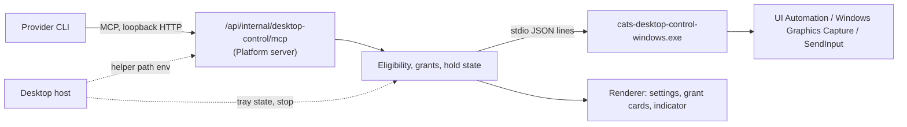

# SPEC-133: Desktop Control Session MCP (Windows)

## Metadata

| Field | Value |
| --- | --- |
| Status | Draft；方向已接受，未授權實作 |
| Owner | Platform Desktop integration |
| Reviewer | Product owner、Runtime maintainers |
| Baseline | Platform `9159757e`；2026-10-29 |
| Plan | [PLAN-126](../plans/PLAN-126-desktop-control-session-mcp.md) |
| Governing decisions | [ADR-141](../decisions/141-host-a-consented-desktop-control-mcp-for-provider-sessions.md)；ADR-126 session 設定；Runtime SPEC-035／SPEC-039 |

## Summary

讓 Cats 起的 provider session 透過一個由 Platform 提供的 session MCP server
`cats-desktop`，在 owner 同意下觀察並操作 Windows 上的原生 app。Server 位於
Desktop 管理的 Platform server，實際的作業系統呼叫交給 Desktop 打包的原生 helper。
工具分兩階段：A 觀察，B 操作；B 在 A 通過真機驗收後才實作。

## Goals and User Stories

- Owner 在 Desktop 開啟桌面控制，對某個對話啟用後，該對話的 Cat 能列出、截圖並讀取
  owner 授權的 app 視窗。
- 每個 app 都要 owner 在 Cats 介面中逐一授權；provider 的核准或「本 session 內允許」
  不能代替。
- 階段 B 中，Cat 能點擊、輸入、按鍵、捲動和使用剪貼簿，每個動作都經過 provider 的
  `tool_approval`，owner 也能隨時停止。
- Owner 能在能力面板看到桌面控制目前是否可用、是否已注入，以及不可用的原因。

## Non-Goals

- macOS、Linux；Bots（另立 ADR）。
- 遠端入口、Mobile、Telegram、life loop、排程或 Cat 之間委派發起的回合。
- 拖曳、hover、全螢幕截圖、多螢幕切換、隱藏其他視窗。
- 啟動任意程式或帶參數執行；shell 與程序管理。
- 操作 UAC／安全桌面、提權視窗，或對終端機、IDE、瀏覽器輸入。
- 保存截圖；整合 provider 原生的 computer use。

## Architecture

- **Helper**：`desktop/native/windows-desktop-control/`，C# .NET，比照
  `desktop/native/windows-stt` 由 `scripts/build-desktop-installer.mjs` 建置、打包、
  簽章，並納入 `scripts/verify-desktop-licenses.mjs`。
- **Helper 路徑**：Desktop host 只在 Windows 上，以環境變數
  `CATS_DESKTOP_CONTROL_HELPER` 把路徑交給 Platform server（`processSupervisor.ts`）。
- **Server 模組**：`src/platform/desktopControl/`，比照 `cat-image-tools`：用
  `handleMcpHttpRequest` 提供 endpoint，用 `McpSessionGrantStore` 發 session bearer token。
- **注入**：新的 `SessionMcpServerContributor`，origin 為 `{ kind: 'desktop' }`，
  server 名稱 `cats-desktop`（`sessionMcpServerName` 增加這個分支）。

## Requirements

### R1. 可用性與設定

| ID | Requirement |
| --- | --- |
| DC-01 | 只有在 Platform server 由 Desktop host 啟動、平台為 Windows、`CATS_DESKTOP_CONTROL_HELPER` 存在，且 helper `hello` 握手成功（版本與 protocol 相符）時才可用。否則設定頁顯示 `unavailable` 與原因，contributor 不輸出任何 server |
| DC-02 | 全域設定預設關閉，只有 owner 能變更。關閉時撤銷所有授權與控制、取消進行中的 helper 動作，並結束 helper 程序 |
| DC-03 | 每個對話另有啟用開關，預設關閉並持久保存。關閉時撤銷該對話的授權與控制 |

### R2. 注入與回合範圍

| ID | Requirement |
| --- | --- |
| DC-04 | Contributor 只在 DC-01～03 都成立，而且 Runtime 為該 session 回報的有效 policy（SPEC-039）是明確的 `on-request` 或 `untrusted`、已協商互動 host、注入的 MCP 工具會走互動核准時，才加入 `cats-desktop`。`skip`、`never`、沒有 policy 或回報不符時都不注入，能力面板顯示原因 |
| DC-05 | 工具只在「owner 從本機 Desktop 視窗送出」的回合內提供服務。經 public ingress（`platformRequestEntry(...).publicEntry`）、Mobile、Telegram、life loop、排程或 Cat 委派發起的回合，所有工具回傳 `not_owner_present`。回合範圍在 send 時決定，不變更 descriptor，避免 SPEC-035 SMCP-08 的 worker 重啟 |
| DC-06 | Session bearer token 不寫入 log，session 移除、停止或關閉時撤銷 |
| DC-07 | `/api/internal/desktop-control/` 加入 `isInternalPlatformRoute`，只能從 internal listener 存取，ingress 一律拒絕 |

### R3. App 授權

| ID | Requirement |
| --- | --- |
| DC-08 | `request_app_access({apps, reason})` 透過 helper 把名稱（含在地化顯示名稱與 exe 名稱）解析成可執行檔身分：路徑、簽章發行者、產品名稱。Platform 在對話中建立授權卡，最多等待 60 秒，逐一回傳 `granted`／`denied`／`pending`。只有 owner 在授權卡上操作才算數 |
| DC-09 | 授權以「可執行檔路徑 + 簽章發行者」比對，不使用視窗標題。範圍是該對話的該 session，只存在記憶體；session 移除、停止、關閉或 Platform 重啟時清除 |
| DC-10 | 排除清單由 helper 強制：Cats Desktop 與其 helper 一律不可授權；系統安全介面（如 `consent.exe`、`LogonUI.exe`、認證對話框）一律不可授權；終端機與 IDE（如 Windows Terminal、conhost、PowerShell、cmd、VS Code、Visual Studio、JetBrains IDE）與瀏覽器（Chrome、Edge、Firefox、Brave、Opera）只能觀察。清單有測試涵蓋 |

### R4. 階段 A 工具：觀察

| Tool | 行為 |
| --- | --- |
| `request_app_access` | 見 DC-08 |
| `list_windows` | 已授權 app 的可見頂層視窗：`window_id`（session 內不透明 ID）、app、標題、位置大小、是否最小化或在前景 |
| `screenshot_window({window_id, max_edge?})` | 用 Windows Graphics Capture 擷取單一視窗（失敗時用 `PrintWindow` 搭配 `PW_RENDERFULLCONTENT`），不擷取螢幕區域。圖片縮到 `max_edge` 以內（預設 1568），回傳 MCP image content 與 `snapshot_id`；`snapshot_id` 綁定視窗、位置大小、時間與縮放比例 |
| `read_ui({window_id, max_nodes?})` | 該視窗的 UI Automation 子樹：`element_id`、角色、名稱、值、是否啟用、是否有焦點、在截圖座標中的位置、支援的動作。預設 200 個節點，上限 1000。`IsPassword` 元素不回傳值 |
| `open_app({app})` | 以授權時記錄的可執行檔路徑啟動，不帶參數 |

### R5. 階段 B 工具：操作

輸入類工具共同規則：目標視窗必須已授權且不在只能觀察的類別；helper 先以 UIA
`SetFocus` 把視窗帶到前景並確認；`GetLastInputInfo` 顯示 owner 在 3 秒內有輸入時回傳
`operator_active`，不搶焦點；輸入到提權視窗回傳 `elevated_target`。

| Tool | 行為 |
| --- | --- |
| `click({snapshot_id, x, y, button?, count?})` | 套用 PR #336 的防護：截圖 60 秒內、同一視窗、未移動、座標在截圖內、該點未被不屬於目標的視窗遮住、沒有按住的鍵、游標精準落點、尊重左右鍵對調。座標依 `snapshot_id` 的縮放比例換算 |
| `invoke_element({element_id, action})` | 用 UIA pattern（invoke、toggle、select、expand）操作，優先於 `click` |
| `type_text({window_id, text})` | 焦點元素必須屬於該視窗且不是 `IsPassword`；最多 2000 字元，不含控制字元 |
| `key({window_id, keys})` | 只接受允許清單：Enter、Esc、Tab、方向鍵、PageUp／Down、Home／End、Backspace、Delete、F1～F12，以及 Ctrl+A／C／V／X／Z／Y／S／F。不接受 Win 鍵組合、Alt+Tab、Ctrl+Alt+Del |
| `scroll({snapshot_id, x, y, direction, amount})` | 與 `click` 相同的座標防護，amount 1～10 |
| `clipboard_read()` / `clipboard_write({text})` | 只處理文字，上限 100,000 字元；寫入後讀回核對 |

### R6. 控制中狀態、提示與停止

| ID | Requirement |
| --- | --- |
| DC-11 | 回合內第一個輸入動作開始「控制中」，回合結束時解除。控制中時，Desktop 顯示系統匣狀態與一個置頂提示（app 名稱與「停止」），提示視窗屬於 Cats，不可被操作 |
| DC-12 | 停止可從提示、系統匣與對話中觸發：撤銷該對話授權、解除控制、取消 helper 進行中的動作；之後的呼叫回傳 `stopped`，直到 owner 重新授權 |
| DC-13 | 螢幕鎖定或切換使用者（WTS 通知）時，所有動作回傳 `locked`，解鎖後不自動恢復進行中的動作 |

### R7. Helper protocol

| ID | Requirement |
| --- | --- |
| DC-14 | stdio JSON lines：request `{id, op, params}`，response `{id, ok, result}` 或 `{id, ok: false, error: {code, message}}`。Op：`hello`、`resolve_apps`、`list_windows`、`capture_window`、`read_ui`、`open_app`、`state`、`cancel`；階段 B 加上 `click`、`invoke`、`type`、`key`、`scroll`、`clipboard_read`、`clipboard_write` |
| DC-15 | 以目前使用者身分執行、不提權、per-monitor DPI aware v2；座標換算都在 helper 內完成 |
| DC-16 | 首次使用時才啟動，閒置 5 分鐘結束。輸入類 op 一次只執行一個。程序崩潰時進行中的呼叫回傳 `executor_failed`，下次呼叫重新啟動；5 分鐘內崩潰 3 次以上回傳 `unavailable` |

### R8. 隱私、記錄與能力回報

| ID | Requirement |
| --- | --- |
| DC-17 | Platform 不在自己的儲存、log、debug trace 或活動 feed 保存截圖 bytes、UIA 值、輸入文字或剪貼簿內容；活動只顯示摘要，例如「截圖：記事本」 |
| DC-18 | 能力面板列出「Cats 桌面控制」，狀態為 `unavailable`（含原因）、`off`、`not_injected`（含原因）、`injected`、`active_turn` 或 `holding`。Provider 原生的 computer use 照 Runtime 回報顯示，兩者分開 |

### 錯誤代碼

`unavailable`、`not_owner_present`、`not_granted`、`excluded_app`、`observe_only`、
`operator_active`、`locked`、`stopped`、`stale_snapshot`、`window_changed`、`covered`、
`not_foreground`、`elevated_target`、`password_field`、`executor_failed`。每個錯誤都附
一句給模型的說明，不暗示可用其他方式繞過。

## Acceptance Criteria

| ID | Required evidence |
| --- | --- |
| A1 | 非 Windows、沒有 helper、握手失敗時不注入，設定頁顯示原因 |
| A2 | 注入矩陣：全域關、對話關、`skip`、`never`、沒有互動 host、ingress 回合、life loop 回合都無法使用工具；本機 owner 回合加明確 `on-request` policy 時注入，且真實 Claude Code 每次呼叫都出現 `tool_approval` |
| A3 | 授權卡：provider 核准與「本 session 內允許」都無法授權 app；排除清單被拒絕；停止、關閉、重啟後授權清除 |
| A4 | 觀察：視窗上疊一個已知顏色的未授權視窗，截圖不含其像素；`read_ui` 不含密碼值；節點數受限 |
| A5 | 停止、鎖定與 owner 正在操作時的暫停在真機驗證 |
| A6 | Helper 握手、崩潰重啟、閒置結束；打包版在 Defender 沒有偵測紀錄 |
| A7 | 階段 B：各輸入工具的防護 fixture，加上用一次性測試視窗的真機驗收 |
| A8 | Log、遙測與 transcript 中沒有截圖 bytes、輸入文字或剪貼簿內容 |

## Open Questions

- Codex 的 MCP image content 是否送達模型，於 A2 一併確認；不支援時該 provider 只提供 `read_ui`。
- 停止是否需要全域快捷鍵，於階段 A 的 UI 驗收後決定。

*Created: 2026-10-29. Draft; implementation not authorized.*
