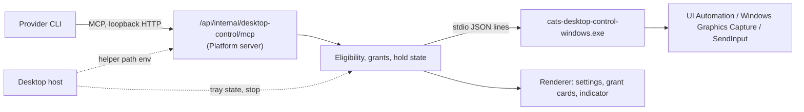

# SPEC-133: Desktop Control Session MCP (Windows)

## Metadata

| Field | Value |
| --- | --- |
| Status | Draft; direction accepted, implementation not authorized |
| Owner | Platform Desktop integration |
| Reviewer | Product owner, Runtime and Bots maintainers |
| Baseline | Platform `9159757e`; 2026-10-29 |
| Plan | [PLAN-126](../plans/PLAN-126-desktop-control-session-mcp.md) |
| Governing decisions | [ADR-141](../decisions/141-host-a-consented-desktop-control-mcp-for-provider-sessions.md); ADR-126 session configuration; Runtime SPEC-035 / SPEC-039 |

## Summary

Let provider sessions that Cats starts observe and operate native Windows apps, with the
owner's consent, through a Platform-provided session MCP server named `cats-desktop`. The
server lives on the Desktop-managed Platform server; the actual OS calls go to a native
helper that Desktop packages. Tools come in two phases, A (observe) and B (act); phase B is
implemented only after phase A passes native acceptance.

Cats Bots implements the same capability separately in
[Bots SPEC-006](../../../cats-bots/docs/specs/SPEC-006-desktop-control-session-mcp.md).
Both follow the [cross-implementation contract](#cross-implementation-contract) below.

## Goals and User Stories

- After the owner turns desktop control on in Desktop and enables it for a conversation,
  that conversation's Cat can list, capture and read the windows of apps the owner granted.
- The owner grants each app individually in Cats' own UI; a provider approval or "allow for
  this session" cannot stand in for that.
- In phase B, the Cat can click, type, press keys, scroll and use the clipboard. Every action
  goes through the provider's `tool_approval`, and the owner can stop at any time.
- The capability panel shows whether desktop control is available and injected, and why not
  when it is not.

## Non-Goals

- macOS and Linux.
- The Bots implementation; [Bots SPEC-006](../../../cats-bots/docs/specs/SPEC-006-desktop-control-session-mcp.md)
  implements it against this document's cross-implementation contract.
- Turns started by remote ingress, Mobile, Telegram, the life loop, schedules or Cat-to-Cat
  delegation.
- Drag, hover, full-screen capture, display switching and hiding other windows.
- Launching arbitrary programs or passing arguments; shell and process management.
- Operating UAC or the secure desktop, elevated windows, or typing into terminals, IDEs or
  browsers.
- Storing screenshots; integrating provider-native computer use.

## Architecture

- **Helper**: `desktop/native/windows-desktop-control/`, C# .NET. Like
  `desktop/native/windows-stt`, it is built, packaged and signed by
  `scripts/build-desktop-installer.mjs` and included in `scripts/verify-desktop-licenses.mjs`.
- **Helper path**: on Windows only, the Desktop host passes the path to the Platform server
  (`processSupervisor.ts`) in `CATS_DESKTOP_CONTROL_HELPER`.
- **Server module**: `src/platform/desktopControl/`, modeled on `cat-image-tools`. It serves
  the endpoint with `handleMcpHttpRequest` and issues session bearer tokens with
  `McpSessionGrantStore`.
- **Injection**: a new `SessionMcpServerContributor` with origin `{ kind: 'desktop' }` and
  server name `cats-desktop` (`sessionMcpServerName` gains this branch).

## Requirements

### R1. Availability and settings

| ID | Requirement |
| --- | --- |
| DC-01 | Available only when the Desktop host started the Platform server, the platform is Windows, `CATS_DESKTOP_CONTROL_HELPER` is set and the helper's `hello` handshake succeeds (matching version and protocol). Otherwise settings show `unavailable` with the reason and the contributor emits no server |
| DC-02 | A global setting, off by default, that only the owner can change. Turning it off revokes all grants and control, cancels helper actions in progress and ends the helper process |
| DC-03 | A per-conversation switch, off by default and persisted. Turning it off revokes that conversation's grants and control |

### R2. Injection and turn scope

| ID | Requirement |
| --- | --- |
| DC-04 | The contributor adds `cats-desktop` only when DC-01 to DC-03 hold and the effective policy Runtime reports for the session (SPEC-039) is an explicit `on-request` or `untrusted`, with a negotiated interaction host, under which injected MCP tools require interactive approval. With `skip`, `never`, no policy or a mismatched report, nothing is injected and the capability panel shows why |
| DC-05 | Tools serve only turns the owner sent from the local Desktop window. For turns started through the public ingress entry (`platformRequestEntry(...).publicEntry`), Mobile, Telegram, the life loop, schedules or Cat delegation, every tool returns `not_owner_present`. Turn scope is decided at send time without changing the descriptor, which avoids the worker restart of SPEC-035 SMCP-08 |
| DC-06 | Session bearer tokens are never logged and are revoked when the session is removed, stopped or turned off |
| DC-07 | `/api/internal/desktop-control/` is added to `isInternalPlatformRoute`: reachable only from the internal listener and always refused through ingress |

### R3. App grants

| ID | Requirement |
| --- | --- |
| DC-08 | `request_app_access({apps, reason})` has the helper resolve names (including localized display names and exe names) to an executable identity: path, signing publisher and product name. Platform posts a grant card in the conversation, waits at most 60 seconds and returns `granted`, `denied` or `pending` per app. Only the owner acting on the card counts |
| DC-09 | Grants match on executable path plus signing publisher, never on window title. They are scoped to that conversation's session and kept only in memory; removing the session, stopping, turning the feature off or restarting Platform clears them |
| DC-10 | The helper enforces an exclusion list. Cats Desktop and its helpers can never be granted. System security UI (such as `consent.exe`, `LogonUI.exe` and credential dialogs) can never be granted. Terminals and IDEs (such as Windows Terminal, conhost, PowerShell, cmd, VS Code, Visual Studio and JetBrains IDEs) and browsers (Chrome, Edge, Firefox, Brave, Opera) are observe only. The list has test coverage |

### R4. Phase A tools: observe

| Tool | Behavior |
| --- | --- |
| `request_app_access` | See DC-08 |
| `list_windows` | Visible top-level windows of granted apps: `window_id` (opaque, session-scoped), app, title, bounds, minimized or foreground |
| `screenshot_window({window_id, max_edge?})` | Captures one window with Windows Graphics Capture (falling back to `PrintWindow` with `PW_RENDERFULLCONTENT`); never a screen region. The image is scaled to fit `max_edge` (default 1568) and returned as MCP image content with a `snapshot_id` bound to the window, its bounds, the time and the scale factor |
| `read_ui({window_id, max_nodes?})` | The window's UI Automation subtree: `element_id`, role, name, value, enabled, focused, bounds in snapshot coordinates and supported actions. 200 nodes by default, at most 1000. `IsPassword` elements never return a value |
| `open_app({app})` | Starts a granted app from the executable path recorded at grant time, without arguments |

### R5. Phase B tools: act

Shared rules for input tools: the target window must be granted and not in an observe-only
category; the helper first brings it to the foreground with UIA `SetFocus` and confirms it;
when `GetLastInputInfo` shows owner input within 3 seconds, the tool returns
`operator_active` instead of taking focus; input into an elevated window returns
`elevated_target`.

| Tool | Behavior |
| --- | --- |
| `click({snapshot_id, x, y, button?, count?})` | Applies the PR #336 guards: snapshot no older than 60 seconds, same window, not moved, point inside the snapshot, point not covered by a window the target does not own, no held keys, exact cursor landing, and swapped mouse buttons honored. Coordinates are converted with the `snapshot_id` scale factor |
| `invoke_element({element_id, action})` | Operates through UIA patterns (invoke, toggle, select, expand); preferred over `click` |
| `type_text({window_id, text})` | The focused element must belong to the window and must not be `IsPassword`; at most 2000 characters, no control characters |
| `key({window_id, keys})` | Allowlist only: Enter, Esc, Tab, arrow keys, PageUp/PageDown, Home/End, Backspace, Delete, F1–F12 and Ctrl+A/C/V/X/Z/Y/S/F. Win-key combinations, Alt+Tab and Ctrl+Alt+Del are refused |
| `scroll({snapshot_id, x, y, direction, amount})` | The same coordinate guards as `click`; amount 1–10 |
| `clipboard_read()` / `clipboard_write({text})` | Text only, at most 100,000 characters; a write is read back and compared |

### R6. Holding control, indicator and stop

| ID | Requirement |
| --- | --- |
| DC-11 | The first input action in a turn starts holding control, and the end of the turn releases it. While control is held, Desktop shows the tray state and a topmost notice (app name and "Stop"). The notice is a Cats window and cannot be operated |
| DC-12 | Stop is available from the notice, the tray and the conversation. It revokes the conversation's grants, releases control and cancels the helper action in progress; later calls return `stopped` until the owner grants again |
| DC-13 | While the screen is locked or the user session is switched (WTS notifications), every action returns `locked`. Actions in progress do not resume automatically after unlock |

### R7. Helper protocol

| ID | Requirement |
| --- | --- |
| DC-14 | stdio JSON lines: request `{id, op, params}`, response `{id, ok, result}` or `{id, ok: false, error: {code, message}}`. Ops: `hello`, `resolve_apps`, `list_windows`, `capture_window`, `read_ui`, `open_app`, `state`, `cancel`; phase B adds `click`, `invoke`, `type`, `key`, `scroll`, `clipboard_read` and `clipboard_write` |
| DC-15 | Runs as the current user, unelevated and per-monitor DPI aware v2; all coordinate conversion happens inside the helper |
| DC-16 | Started on first use and exits after 5 idle minutes. Only one input op runs at a time. If the process crashes, calls in progress return `executor_failed` and the next call restarts it; after more than 3 crashes within 5 minutes, calls return `unavailable` |

### R8. Privacy, logging and capability reporting

| ID | Requirement |
| --- | --- |
| DC-17 | Platform keeps no screenshot bytes, UIA values, typed text or clipboard content in its own stores, logs, debug traces or activity feed; activity shows a summary only, such as "Screenshot: Notepad" |
| DC-18 | The capability panel lists "Cats desktop control" with the state `unavailable` (with reason), `off`, `not_injected` (with reason), `injected`, `active_turn` or `holding`. Provider-native computer use is shown as Runtime reports it, separately |

### Error codes

`unavailable`, `not_owner_present`, `not_granted`, `excluded_app`, `observe_only`,
`operator_active`, `locked`, `stopped`, `stale_snapshot`, `window_changed`, `covered`,
`not_foreground`, `elevated_target`, `password_field`, `executor_failed`. Each error carries
one sentence for the model and never suggests another way around it.

## Cross-implementation contract

Cats Desktop (this document) and Cats Bots
([SPEC-006](../../../cats-bots/docs/specs/SPEC-006-desktop-control-session-mcp.md)) implement
desktop control separately, but the following must match so the model and the owner see the
same behavior in both. A change on either side updates both SPECs on the same day, and each
implementation follows.

- **Name**: MCP server name `cats-desktop`.
- **Tools**: the tool names, parameters, returned fields, limits and guards in R4 and R5.
- **Error codes**: the codes and meanings under "Error codes".
- **Injection and turns**: the policy condition in DC-04, and the meaning of DC-05: only turns
  the owner sends from a local surface; autonomous or remote turns always get
  `not_owner_present`.
- **Grants**: how grants are made and scoped (DC-08, DC-09) and the exclusion categories
  (DC-10). Each implementation also adds its own windows to the never-grantable list.
- **Holding control and stop**: the meaning of DC-11 to DC-13.
- **Privacy**: DC-17.
- **Capability states**: the state values in DC-18.

Each implementation decides for itself: where settings and switches live (DC-01 to DC-03),
the grant card and indicator UI, the endpoint and routing (DC-07), and the helper's
implementation, protocol and packaging (R7).

## Acceptance Criteria

| ID | Required evidence |
| --- | --- |
| A1 | Nothing is injected on non-Windows platforms, without the helper or after a failed handshake, and settings show the reason |
| A2 | Injection matrix: with the global switch off, the conversation switch off, `skip`, `never`, no interaction host, an ingress turn or a life loop turn, no tool can be used; a local owner turn with an explicit `on-request` policy is injected, and a real Claude Code run shows a `tool_approval` for every call |
| A3 | Grant cards: neither a provider approval nor "allow for this session" can grant an app; excluded apps are refused; grants are cleared after stop, turning the feature off and restart |
| A4 | Observation: with a known-color ungranted window laid over a granted one, the screenshot contains none of its pixels; `read_ui` contains no password values; the node count is bounded |
| A5 | Stop, lock and the pause while the owner is operating are verified on a real desktop |
| A6 | Helper handshake, crash restart and idle exit; the packaged build leaves no Defender detection |
| A7 | Phase B: guard fixtures for every input tool, plus native acceptance against a throwaway test window |
| A8 | Logs, telemetry and transcripts contain no screenshot bytes, typed text or clipboard content |

## Open Questions

- Whether Codex delivers MCP image content to the model is checked during A2. If it does
  not, that provider gets `read_ui` only.
- Whether stop needs a global hotkey is decided after phase A's UI acceptance.

*Created: 2026-10-29. Draft; implementation not authorized.*
